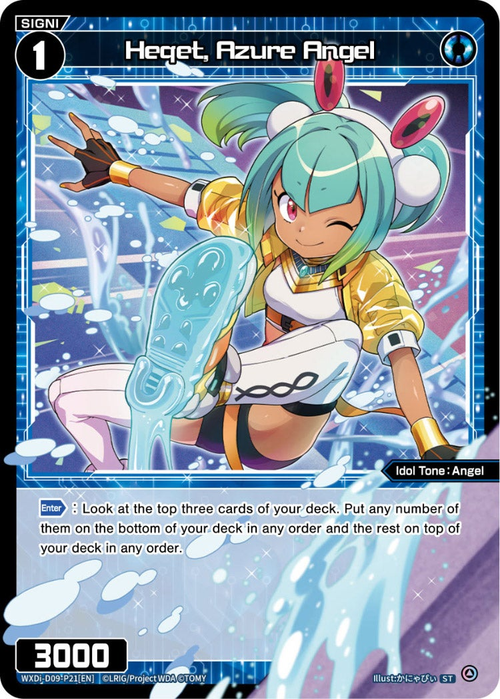

# Heqet, Azure Angel

## Thông tin lá

| Trường | Giá trị |
| --- | --- |
| Mã in | WXDi-D09-P21[EN] |
| Set | WXDi-D09[EN] |
| Loại thẻ | SIGNI |
| Vị trí | Main Deck |
| Deck | Piruluk |
| Số bản D09 | 4 |
| Màu | Xanh dương |
| Độ hiếm | ST |
| Minh họa | かにゃぴぃ |
| Level | 1 |
| Limit | — |
| Power | 3000 |
| LRIG type / Class | Idol Tone：Angel |
| Team / Master | — |
| Cost | — |
| Grow cost | — |
| Use timing | — |
| Life Burst | Không |

## Card text chính thức

[Enter]: Look at the top three cards of your deck. Put any number of them on the bottom of your deck in any order and the rest on top of your deck in any order.

## Power text / Life Burst

—

## Ghi chú minh họa
Artist: かにゃぴぃ. Ảnh ST được tải từ Card List tiếng Anh.

## FAQ chính thức

— (không có FAQ riêng cho mã này trên trang FAQ tiếng Anh.)

## Nguồn
[Card List/FAQ chính thức](https://www.takaratomy.co.jp/products/en.wixoss/card/card.html?card_no=WXDi-D09-P21%5BEN%5D ) · [Ảnh thẻ](https://www.takaratomy.co.jp/products/en.wixoss/card/thumb/WXDi-D09-P21%5BEN%5D.jpg)
