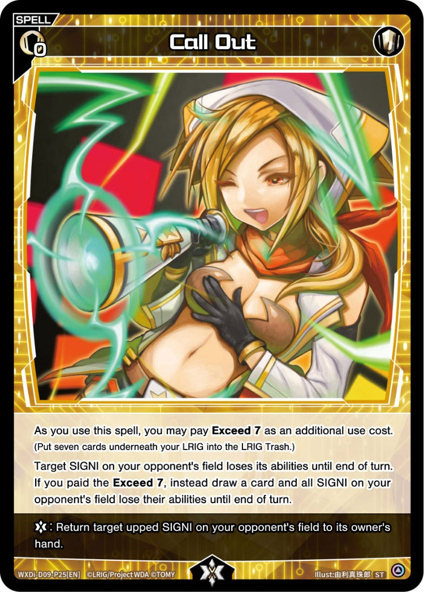

# Call Out

## Thông tin lá

| Trường | Giá trị |
| --- | --- |
| Mã in | WXDi-D09-P25[EN] |
| Set | WXDi-D09[EN] |
| Loại thẻ | SPELL |
| Vị trí | Main Deck |
| Deck | Piruluk |
| Số bản D09 | 2 |
| Màu | Trắng |
| Độ hiếm | ST |
| Minh họa | 由利真珠郎 |
| Level | — |
| Limit | — |
| Power | 0 |
| LRIG type / Class | — |
| Team / Master | — |
| Cost | 《W》×０ |
| Grow cost | — |
| Use timing | — |
| Life Burst | Có |

## Card text chính thức

As you use this spell, you may pay Exceed 7 as an additional use cost. (Put seven cards underneath your LRIG into the LRIG Trash.)

Target SIGNI on your opponent's field loses its abilities until end of turn. If you paid the Exceed 7, instead draw a card and all SIGNI on your opponent's field lose their abilities until end of turn.

## Power text / Life Burst

Return target upped SIGNI on your opponent's field to its owner's hand.

## Ghi chú minh họa
Artist: 由利真珠郎. Ảnh ST được tải từ Card List tiếng Anh.

## FAQ chính thức

— (không có FAQ riêng cho mã này trên trang FAQ tiếng Anh.)

## Nguồn
[Card List/FAQ chính thức](https://www.takaratomy.co.jp/products/en.wixoss/card/card.html?card_no=WXDi-D09-P25%5BEN%5D ) · [Ảnh thẻ](https://www.takaratomy.co.jp/products/en.wixoss/card/thumb/WXDi-D09-P25%5BEN%5D.jpg)
