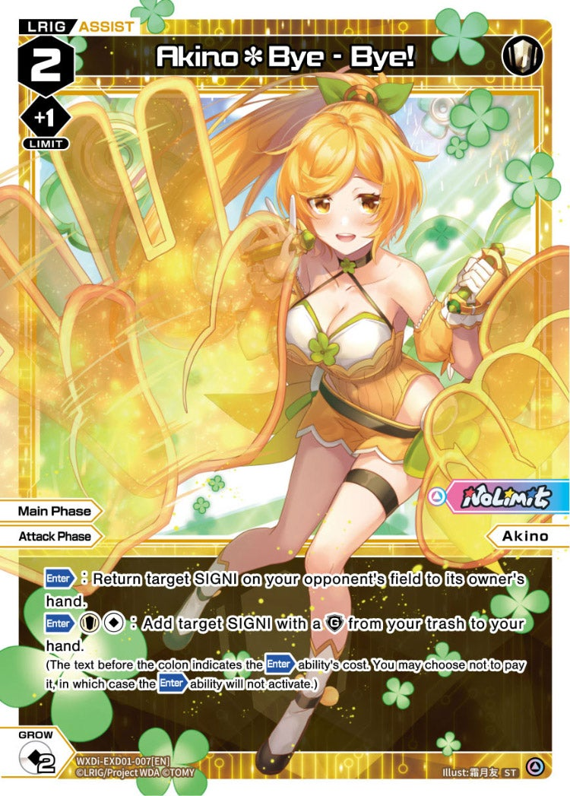

# Akino*Bye - Bye!

## Thông tin lá

| Trường | Giá trị |
| --- | --- |
| Mã in | WXDi-EXD01-007[EN] |
| Set | WXDi-EXD01[EN] |
| Loại thẻ | ASSIST LRIG |
| Vị trí | LRIG Deck |
| Số bản EXD01 | 1 |
| Màu | Trắng |
| Độ hiếm | LC,LC(P) |
| Minh họa | 霜月友 |
| Level | 2 |
| Limit | ＋１ |
| Power | 0 |
| LRIG type / Class | Akino |
| Team / Master | No Limit |
| Cost | — |
| Grow cost | 《C》×２ |
| Use timing | Main Phase / Attack Phase |
| Life Burst | Không |

## Card text chính thức

[Enter]: Return target SIGNI on your opponent's field to its owner's hand.
[Enter] {White} {Colorless}: Add target SIGNI with a {Guard Icon} from your trash to your hand.
(The text before the colon indicates the [Enter] ability's cost. You may choose not to pay it, in which case the [Enter] ability will not activate.)

## Power text / Life Burst

—

## Ghi chú minh họa
Artist: 霜月友. Ảnh LC được tải từ Card List tiếng Anh.

## FAQ chính thức

— (không có FAQ riêng cho mã này trên trang FAQ tiếng Anh.)

## Ảnh biến thể

- LC(P): không có ảnh biến thể trên CDN; dùng ảnh gốc.

## Nguồn
[Card List/FAQ chính thức](https://www.takaratomy.co.jp/products/en.wixoss/card/card.html?card_no=WXDi-EXD01-007%5BEN%5D ) · [Ảnh thẻ](https://www.takaratomy.co.jp/products/en.wixoss/card/thumb/WXDi-EXD01-007%5BEN%5D.jpg)
