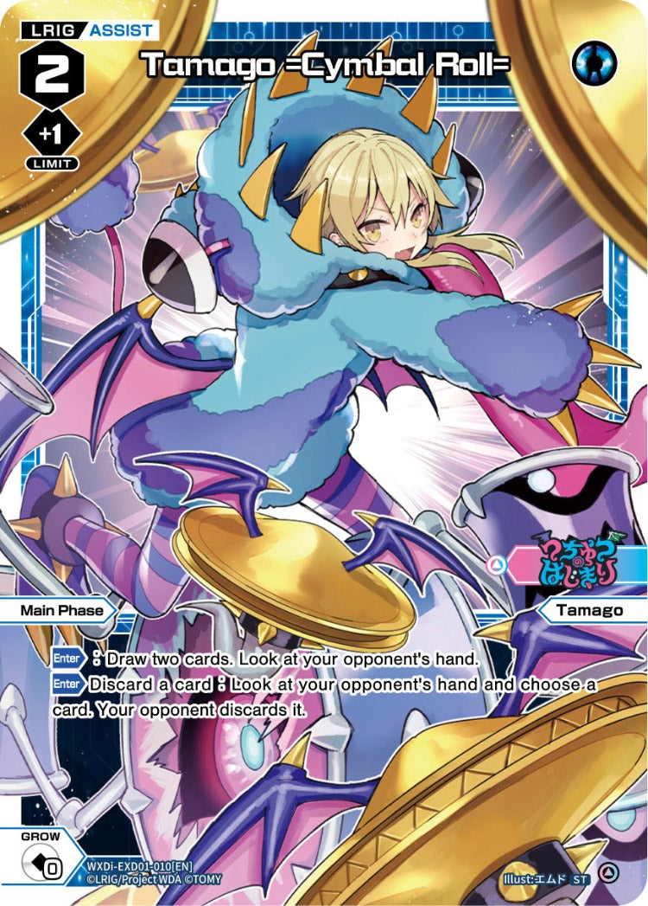

# Tamago =Cymbal Roll=

## Thông tin lá

| Trường | Giá trị |
| --- | --- |
| Mã in | WXDi-EXD01-010[EN] |
| Set | WXDi-EXD01[EN] |
| Loại thẻ | ASSIST LRIG |
| Vị trí | LRIG Deck |
| Số bản EXD01 | 1 |
| Màu | Xanh dương |
| Độ hiếm | LC,LC(P) |
| Minh họa | エムド |
| Level | 2 |
| Limit | ＋1 |
| Power | 0 |
| LRIG type / Class | Tamago |
| Team / Master | UCHU NO HAJIMARI |
| Cost | — |
| Grow cost | 《C》×０ |
| Use timing | Main Phase |
| Life Burst | Không |

## Card text chính thức

[Enter]: Draw two cards. Look at your opponent's hand.
[Enter] Discard a card: Look at your opponent's hand and choose a card. Your opponent discards it.

## Power text / Life Burst

—

## Ghi chú minh họa
Artist: エムド. Ảnh LC được tải từ Card List tiếng Anh.

## FAQ chính thức

— (không có FAQ riêng cho mã này trên trang FAQ tiếng Anh.)

## Nguồn
[Card List/FAQ chính thức](https://www.takaratomy.co.jp/products/en.wixoss/card/card.html?card_no=WXDi-EXD01-010%5BEN%5D ) · [Ảnh thẻ](https://www.takaratomy.co.jp/products/en.wixoss/card/thumb/WXDi-EXD01-010%5BEN%5D.jpg)
