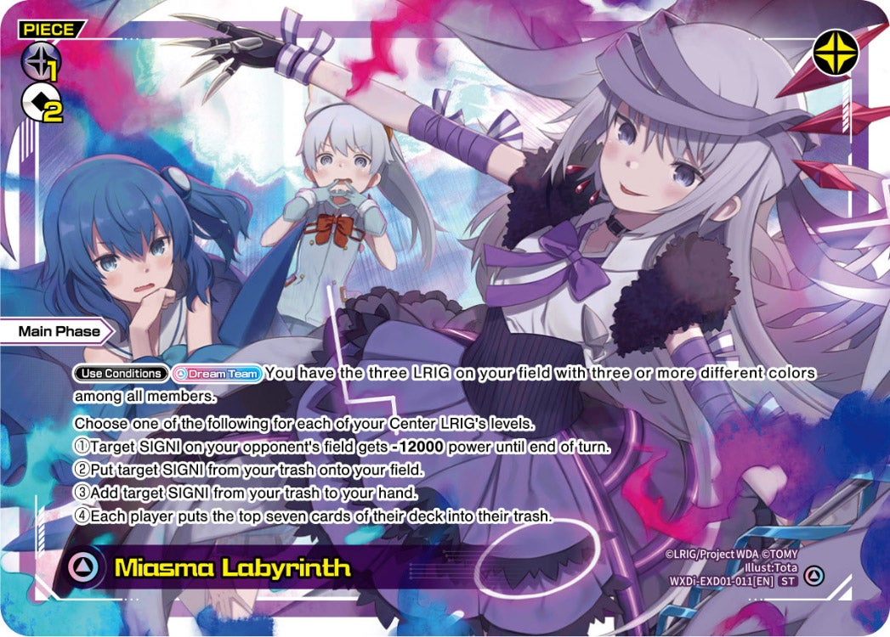

# Miasma Labyrinth

## Thông tin lá

| Trường | Giá trị |
| --- | --- |
| Mã in | WXDi-EXD01-011[EN] |
| Set | WXDi-EXD01[EN] |
| Loại thẻ | PIECE |
| Vị trí | LRIG Deck |
| Số bản EXD01 | 1 |
| Màu | Đen |
| Độ hiếm | ST |
| Minh họa | Tota |
| Level | — |
| Limit | — |
| Power | 0 |
| LRIG type / Class | — |
| Team / Master | — |
| Cost | 《B》×１
《C》×２ |
| Grow cost | — |
| Use timing | Main Phase |
| Life Burst | Không |

## Card text chính thức

[Use Conditions] [Dream Team] You have the three LRIG on your field with three or more different colors among all members.

Choose one of the following for each of your Center LRIG's levels.
①Target SIGNI on your opponent's field gets -12000 power until end of turn.
②Put target SIGNI from your trash onto your field.
③Add target SIGNI from your trash to your hand.
④Each player puts the top seven cards of their deck into their trash.

## Power text / Life Burst

—

## Ghi chú minh họa
Artist: Tota. Ảnh ST được tải từ Card List tiếng Anh.

## FAQ chính thức

— (không có FAQ riêng cho mã này trên trang FAQ tiếng Anh.)

## Nguồn
[Card List/FAQ chính thức](https://www.takaratomy.co.jp/products/en.wixoss/card/card.html?card_no=WXDi-EXD01-011%5BEN%5D ) · [Ảnh thẻ](https://www.takaratomy.co.jp/products/en.wixoss/card/thumb/WXDi-EXD01-011%5BEN%5D.jpg)
