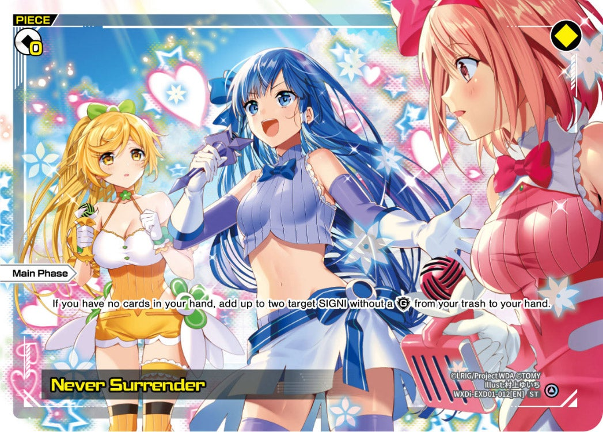

# Never Surrender

## Thông tin lá

| Trường | Giá trị |
| --- | --- |
| Mã in | WXDi-EXD01-012[EN] |
| Set | WXDi-EXD01[EN] |
| Loại thẻ | PIECE |
| Vị trí | LRIG Deck |
| Số bản EXD01 | 1 |
| Màu | Không màu |
| Độ hiếm | ST |
| Minh họa | 村上ゆいち |
| Level | — |
| Limit | — |
| Power | 0 |
| LRIG type / Class | — |
| Team / Master | — |
| Cost | 《C》×０ |
| Grow cost | — |
| Use timing | Main Phase |
| Life Burst | Không |

## Card text chính thức

If you have no cards in your hand, add up to two target SIGNI without a {Guard Icon} from your trash to your hand.

## Power text / Life Burst

—

## Ghi chú minh họa
Artist: 村上ゆいち. Ảnh ST được tải từ Card List tiếng Anh.

## FAQ chính thức

— (không có FAQ riêng cho mã này trên trang FAQ tiếng Anh.)

## Nguồn
[Card List/FAQ chính thức](https://www.takaratomy.co.jp/products/en.wixoss/card/card.html?card_no=WXDi-EXD01-012%5BEN%5D ) · [Ảnh thẻ](https://www.takaratomy.co.jp/products/en.wixoss/card/thumb/WXDi-EXD01-012%5BEN%5D.jpg)
