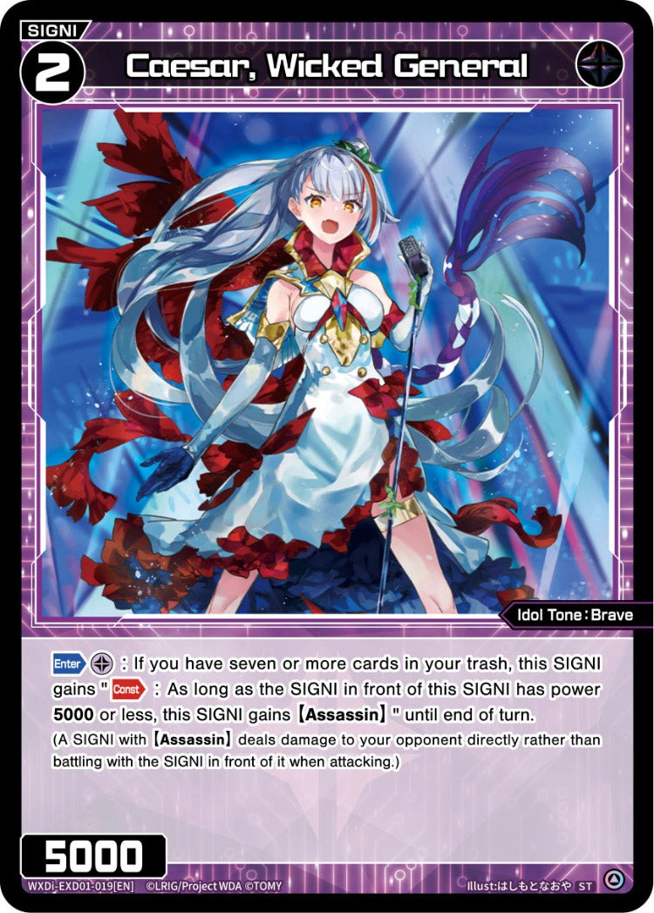

# Caesar, Wicked General

## Thông tin lá

| Trường | Giá trị |
| --- | --- |
| Mã in | WXDi-EXD01-019[EN] |
| Set | WXDi-EXD01[EN] |
| Loại thẻ | SIGNI |
| Vị trí | Main Deck |
| Số bản EXD01 | 2 |
| Màu | Đen |
| Độ hiếm | ST |
| Minh họa | はしもとなおや |
| Level | 2 |
| Limit | — |
| Power | 5000 |
| LRIG type / Class | Idol Tone：Brave |
| Team / Master | — |
| Cost | — |
| Grow cost | — |
| Use timing | — |
| Life Burst | Không |

## Card text chính thức

[Enter] {Black}: If you have seven or more cards in your trash, this SIGNI gains "[Constant]: As long as the SIGNI in front of this SIGNI has power 5000 or less, this SIGNI gains 【Assassin】" until end of turn.
(A SIGNI with 【Assassin】 deals damage to your opponent directly rather than battling with the SIGNI in front of it when attacking.)

## Power text / Life Burst

—

## Ghi chú minh họa
Artist: はしもとなおや. Ảnh ST được tải từ Card List tiếng Anh.

## FAQ chính thức

— (không có FAQ riêng cho mã này trên trang FAQ tiếng Anh.)

## Nguồn
[Card List/FAQ chính thức](https://www.takaratomy.co.jp/products/en.wixoss/card/card.html?card_no=WXDi-EXD01-019%5BEN%5D ) · [Ảnh thẻ](https://www.takaratomy.co.jp/products/en.wixoss/card/thumb/WXDi-EXD01-019%5BEN%5D.jpg)
