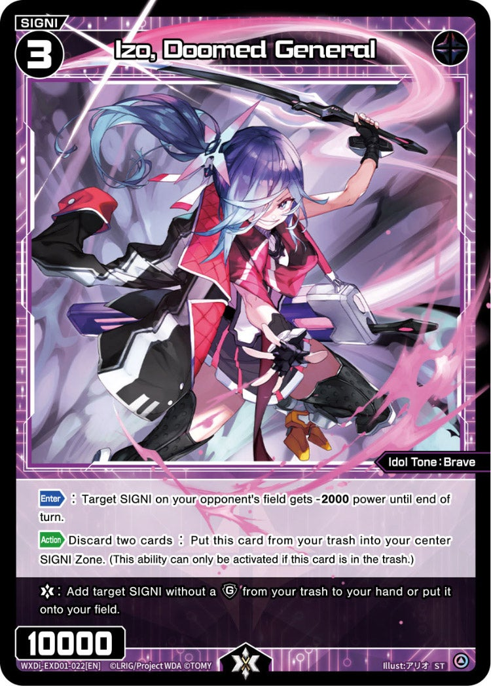

# Izo, Doomed General

## Thông tin lá

| Trường | Giá trị |
| --- | --- |
| Mã in | WXDi-EXD01-022[EN] |
| Set | WXDi-EXD01[EN] |
| Loại thẻ | SIGNI |
| Vị trí | Main Deck |
| Số bản EXD01 | 2 |
| Màu | Đen |
| Độ hiếm | ST |
| Minh họa | アリオ |
| Level | 3 |
| Limit | — |
| Power | 10000 |
| LRIG type / Class | Idol Tone：Brave |
| Team / Master | — |
| Cost | — |
| Grow cost | — |
| Use timing | — |
| Life Burst | Có |

## Card text chính thức

[Enter]: Target SIGNI on your opponent's field gets -2000 power until end of turn.

[Action] Discard two cards: Put this card from your trash into your center SIGNI Zone. (This ability can only be activated if this card is in the trash.)

## Power text / Life Burst

Add target SIGNI without a {Guard Icon} from your trash to your hand or put it onto your field.

## Ghi chú minh họa
Artist: アリオ. Ảnh ST được tải từ Card List tiếng Anh.

## FAQ chính thức

— (không có FAQ riêng cho mã này trên trang FAQ tiếng Anh.)

## Nguồn
[Card List/FAQ chính thức](https://www.takaratomy.co.jp/products/en.wixoss/card/card.html?card_no=WXDi-EXD01-022%5BEN%5D ) · [Ảnh thẻ](https://www.takaratomy.co.jp/products/en.wixoss/card/thumb/WXDi-EXD01-022%5BEN%5D.jpg)
