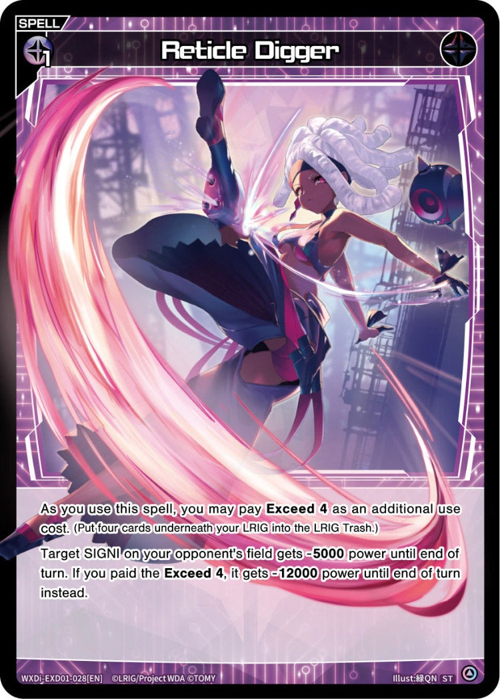

# Reticle Digger

## Thông tin lá

| Trường | Giá trị |
| --- | --- |
| Mã in | WXDi-EXD01-028[EN] |
| Set | WXDi-EXD01[EN] |
| Loại thẻ | SPELL |
| Vị trí | Main Deck |
| Số bản EXD01 | 2 |
| Màu | Đen |
| Độ hiếm | ST |
| Minh họa | 緑QN |
| Level | — |
| Limit | — |
| Power | 0 |
| LRIG type / Class | — |
| Team / Master | — |
| Cost | 《B》×１ |
| Grow cost | — |
| Use timing | — |
| Life Burst | Không |

## Card text chính thức

As you use this spell, you may pay Exceed 4 as an additional use cost. (Put four cards underneath your LRIG into the LRIG Trash.)

Target SIGNI on your opponent's field gets -5000 power until end of turn. If you paid the Exceed 4, it gets -12000 power until end of turn instead.

## Power text / Life Burst

—

## Ghi chú minh họa
Artist: 緑QN. Ảnh ST được tải từ Card List tiếng Anh.

## FAQ chính thức

— (không có FAQ riêng cho mã này trên trang FAQ tiếng Anh.)

## Nguồn
[Card List/FAQ chính thức](https://www.takaratomy.co.jp/products/en.wixoss/card/card.html?card_no=WXDi-EXD01-028%5BEN%5D ) · [Ảnh thẻ](https://www.takaratomy.co.jp/products/en.wixoss/card/thumb/WXDi-EXD01-028%5BEN%5D.jpg)
