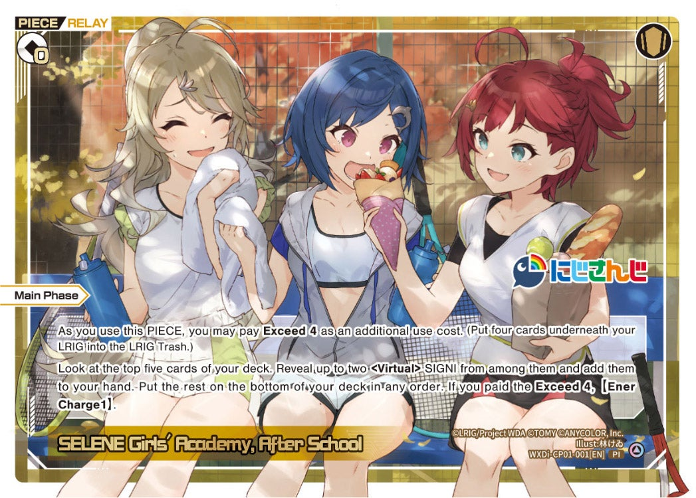

# SELENE Girls' Academy, After School

## Thông tin lá

| Trường | Giá trị |
| --- | --- |
| Mã in | WXDi-CP01-001[EN] |
| Set | WXDi-CP01[EN] |
| Số thứ tự | 001 |
| Loại thẻ | PIECE |
| Vị trí | LRIG Deck |
| Số bản | — (set booster, không áp dụng) |
| Màu | Trắng |
| Độ hiếm | PI,LRP |
| Minh họa | 林けゐ |
| Level | — |
| Limit | — |
| Power | 0 |
| LRIG type / Class | — |
| Team / Master | — |
| Cost | 《C》×０ |
| Grow cost | — |
| Use timing | Main Phase |
| Life Burst | Không |

## Card text chính thức

As you use this PIECE, you may pay Exceed 4 as an additional use cost. (Put four cards underneath your LRIG into the LRIG Trash.)

Look at the top five cards of your deck. Reveal up to two <Virtual> SIGNI from among them and add them to your hand. Put the rest on the bottom of your deck in any order. If you paid the Exceed 4, 【Ener Charge 1】.

## Power text / Life Burst

—

## Ghi chú minh họa
Artist: 林けゐ. Ảnh PI được tải từ Card List tiếng Anh.

## FAQ chính thức

**Q. What is "Relay PIECE"?**
A. It is a type of PIECE. On its own, it is no different from a normal PIECE and has no significance for "Relay", but there are PIECE that can be used by using Relay PIECE.

**Q. How do I pay for the cost of Exceed 4?**
A. You can pay the cost by placing a total of four cards from the bottom of your LRIG, including the center LRIG and the Assist LRIG, into the LRIG trash.

## Ảnh biến thể

- [LRP](../images/WXDi-CP01-001P-EN.jpg)

## Nguồn
[Card List/FAQ chính thức](https://www.takaratomy.co.jp/products/en.wixoss/card/card.html?card_no=WXDi-CP01-001%5BEN%5D ) · [Ảnh thẻ](https://www.takaratomy.co.jp/products/en.wixoss/card/thumb/WXDi-CP01-001%5BEN%5D.jpg)
