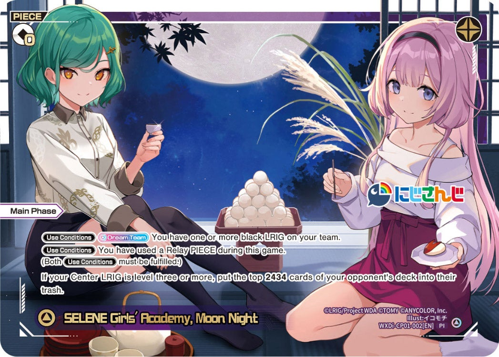

# SELENE Girls' Academy, Moon Night

## Thông tin lá

| Trường | Giá trị |
| --- | --- |
| Mã in | WXDi-CP01-002[EN] |
| Set | WXDi-CP01[EN] |
| Số thứ tự | 002 |
| Loại thẻ | PIECE |
| Vị trí | LRIG Deck |
| Số bản | — (set booster, không áp dụng) |
| Màu | Đen |
| Độ hiếm | PI,LRP |
| Minh họa | イコモチ |
| Level | — |
| Limit | — |
| Power | 0 |
| LRIG type / Class | — |
| Team / Master | — |
| Cost | 《C》×０ |
| Grow cost | — |
| Use timing | Main Phase |
| Life Burst | Không |

## Card text chính thức

[Use Conditions] [Dream Team] You have one or more black LRIG on your team.
[Use Conditions] You have used a Relay PIECE during this game.
(Both [Use Conditions] must be fulfilled.)

If your Center LRIG is level three or more, put the top 2434 cards of your opponent's deck into their trash.

## Power text / Life Burst

—

## Ghi chú minh họa
Artist: イコモチ. Ảnh PI được tải từ Card List tiếng Anh.

## FAQ chính thức

**Q. What is "Relay PIECE"?**
A. It is a type of PIECE. This PIECE can be used by using Relay PIECE.

**Q. There are not 2434 cards in my opponent's deck, what happens to the effect of put them into their owner's trash?**
A. All remaining cards of deck are put into their owner's trash and the effect ends. The deck is refreshed as there are no deck.

## Ảnh biến thể

- [LRP](../images/WXDi-CP01-002P-EN.jpg)

## Nguồn
[Card List/FAQ chính thức](https://www.takaratomy.co.jp/products/en.wixoss/card/card.html?card_no=WXDi-CP01-002%5BEN%5D ) · [Ảnh thẻ](https://www.takaratomy.co.jp/products/en.wixoss/card/thumb/WXDi-CP01-002%5BEN%5D.jpg)
