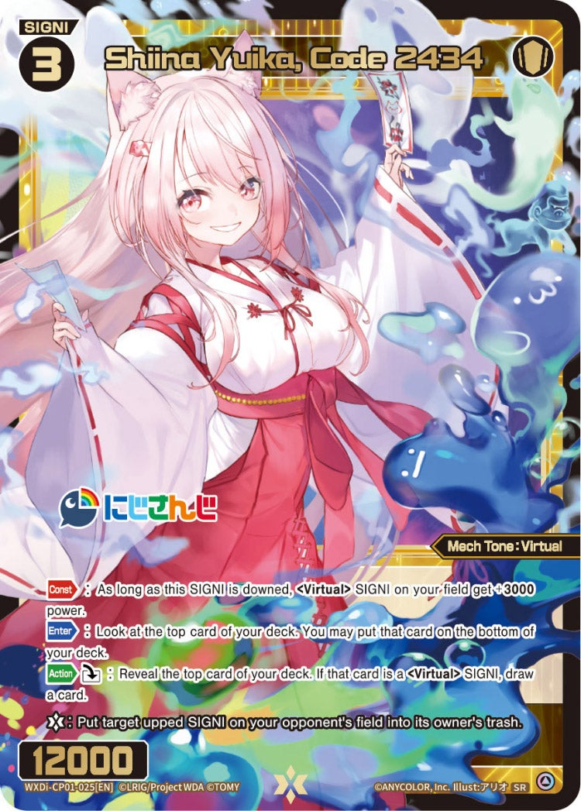

# Shiina Yuika, Code 2434

## Thông tin lá

| Trường | Giá trị |
| --- | --- |
| Mã in | WXDi-CP01-025[EN] |
| Set | WXDi-CP01[EN] |
| Số thứ tự | 025 |
| Loại thẻ | SIGNI |
| Vị trí | Main Deck |
| Số bản | — (set booster, không áp dụng) |
| Màu | Trắng |
| Độ hiếm | SR,SRP |
| Minh họa | アリオ |
| Level | 3 |
| Limit | — |
| Power | 12000 |
| LRIG type / Class | Mech Tone：Virtual |
| Team / Master | — |
| Cost | — |
| Grow cost | — |
| Use timing | — |
| Life Burst | Có |

## Card text chính thức

[Constant]: As long as this SIGNI is downed, <Virtual> SIGNI on your field get +3000 power.
[Enter]: Look at the top card of your deck. You may put that card on the bottom of your deck.
[Action] {Down}: Reveal the top card of your deck. If that card is a <Virtual> SIGNI, draw a card.

## Power text / Life Burst

Put target upped SIGNI on your opponent's field into its owner's trash.

## Ghi chú minh họa
Artist: アリオ. Ảnh SR được tải từ Card List tiếng Anh.

## FAQ chính thức

**Q. Does the [Const] ability also add power to this SIGNI own?**
A. Yes, that SIGNI is also <Virtual>, it gets +3000 power, making it 15000.

## Ảnh biến thể

- [SRP](../images/WXDi-CP01-025P-EN.jpg)

## Nguồn
[Card List/FAQ chính thức](https://www.takaratomy.co.jp/products/en.wixoss/card/card.html?card_no=WXDi-CP01-025%5BEN%5D ) · [Ảnh thẻ](https://www.takaratomy.co.jp/products/en.wixoss/card/thumb/WXDi-CP01-025%5BEN%5D.jpg)
