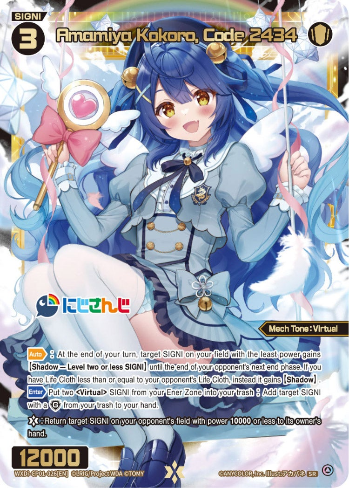

# Amamiya Kokoro, Code 2434

## Thông tin lá

| Trường | Giá trị |
| --- | --- |
| Mã in | WXDi-CP01-026[EN] |
| Set | WXDi-CP01[EN] |
| Số thứ tự | 026 |
| Loại thẻ | SIGNI |
| Vị trí | Main Deck |
| Số bản | — (set booster, không áp dụng) |
| Màu | Trắng |
| Độ hiếm | SR,SRP |
| Minh họa | アカバネ |
| Level | 3 |
| Limit | — |
| Power | 12000 |
| LRIG type / Class | Mech Tone：Virtual |
| Team / Master | — |
| Cost | — |
| Grow cost | — |
| Use timing | — |
| Life Burst | Có |

## Card text chính thức

[Auto]: At the end of your turn, target SIGNI on your field with the least power gains 【Shadow — Level two or less SIGNI】 until the end of your opponent's next end phase. If you have Life Cloth less than or equal to your opponent's Life Cloth, instead it gains 【Shadow】.
[Enter] Put two <Virtual> SIGNI from your Ener Zone into your trash: Add target SIGNI with a {Guard Icon} from your trash to your hand.

## Power text / Life Burst

Return target SIGNI on your opponent's field with power 10000 or less to its owner's hand.

## Ghi chú minh họa
Artist: アカバネ. Ảnh SR được tải từ Card List tiếng Anh.

## FAQ chính thức

**Q. What is 【Shadow - Level two or less SIGNI】?**
A. SIGNI with 【Shadow - Level two or less SIGNI】 is not targeted by the abilities or effects of SIGNI with level two or less. It is likewise not targeted by the Life Burst of SIGNI with level two or less.

## Ảnh biến thể

- [SRP](../images/WXDi-CP01-026P-EN.jpg)

## Nguồn
[Card List/FAQ chính thức](https://www.takaratomy.co.jp/products/en.wixoss/card/card.html?card_no=WXDi-CP01-026%5BEN%5D ) · [Ảnh thẻ](https://www.takaratomy.co.jp/products/en.wixoss/card/thumb/WXDi-CP01-026%5BEN%5D.jpg)
