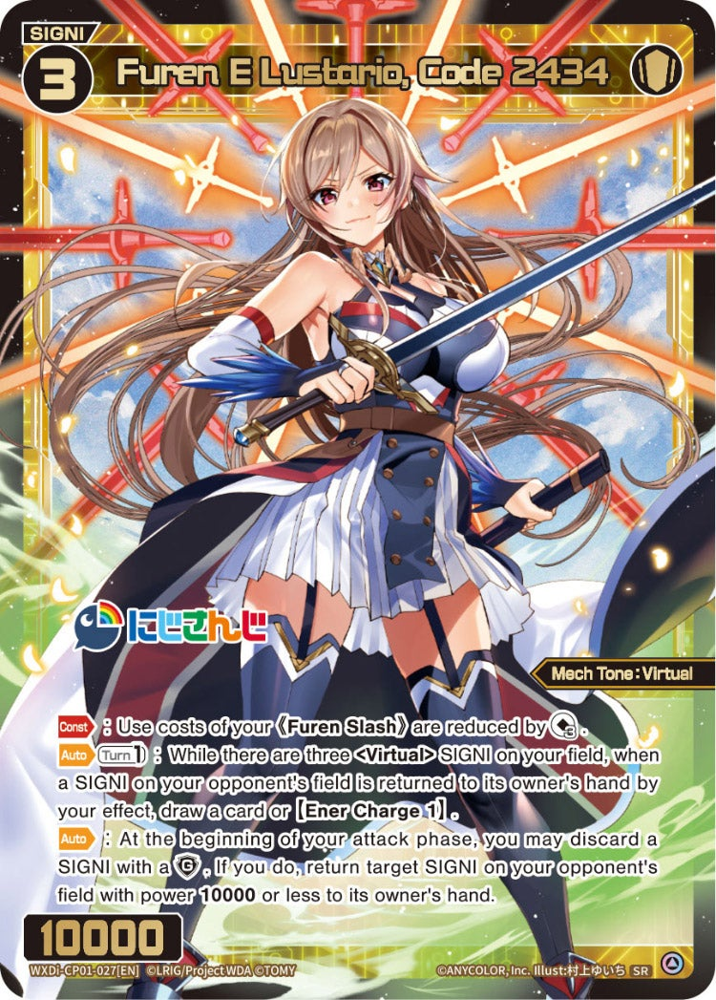

# Furen E Lustario, Code 2434

## Thông tin lá

| Trường | Giá trị |
| --- | --- |
| Mã in | WXDi-CP01-027[EN] |
| Set | WXDi-CP01[EN] |
| Số thứ tự | 027 |
| Loại thẻ | SIGNI |
| Vị trí | Main Deck |
| Số bản | — (set booster, không áp dụng) |
| Màu | Trắng |
| Độ hiếm | SR,SRP |
| Minh họa | 村上ゆいち |
| Level | 3 |
| Limit | — |
| Power | 10000 |
| LRIG type / Class | Mech Tone：Virtual |
| Team / Master | — |
| Cost | — |
| Grow cost | — |
| Use timing | — |
| Life Burst | Không |

## Card text chính thức

[Constant]: Use costs of your 《Furen Slash》 are reduced by {Colorlessx3}.
[Auto] {1/Turn}: While there are three <Virtual> SIGNI on your field, when a SIGNI on your opponent's field is returned to its owner's hand by your effect, draw a card or 【Ener Charge 1】.
[Auto]: At the beginning of your attack phase, you may discard a SIGNI with a {Guard Icon}. If you do, return target SIGNI on your opponent's field with power 10000 or less to its owner's hand.

## Power text / Life Burst

—

## Ghi chú minh họa
Artist: 村上ゆいち. Ảnh SR được tải từ Card List tiếng Anh.

## FAQ chính thức

**Q. If there are only two <Virtual> SIGNI on my field and one of my opponent's SIGNI is returned to its owner's hand by my one of effects, is the first [Auto] ability no longer triggered during that turn because of it has [Turn 1]?**
A. No, it is triggered when the conditions are met. The first [Auto] ability only triggers "while there are three <Virtual> SIGNI on your field", so it is not subject to the [Turn 1] limit.

## Ảnh biến thể

- [SRP](../images/WXDi-CP01-027P-EN.jpg)

## Nguồn
[Card List/FAQ chính thức](https://www.takaratomy.co.jp/products/en.wixoss/card/card.html?card_no=WXDi-CP01-027%5BEN%5D ) · [Ảnh thẻ](https://www.takaratomy.co.jp/products/en.wixoss/card/thumb/WXDi-CP01-027%5BEN%5D.jpg)
