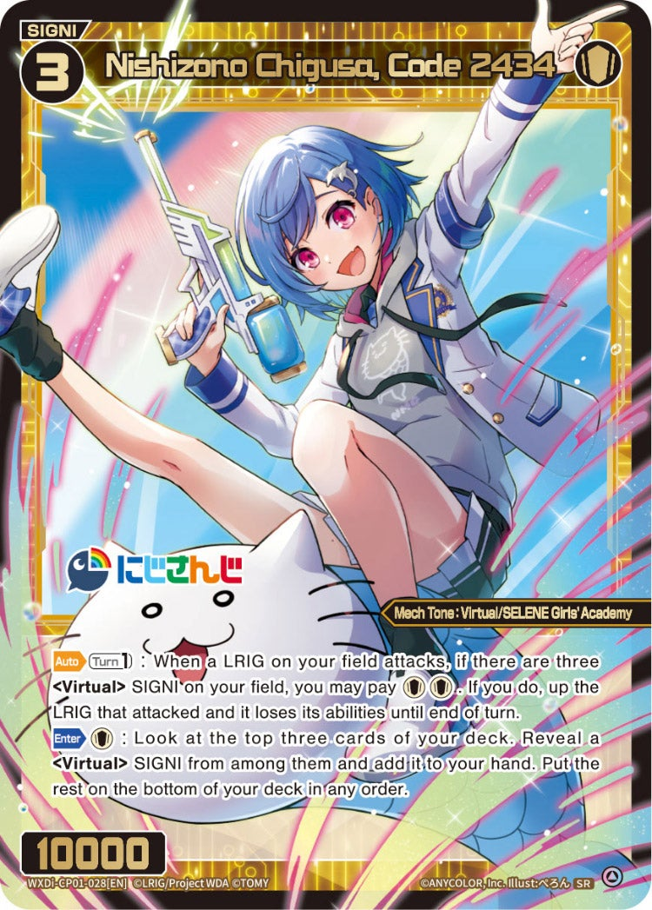

# Nishizono Chigusa, Code 2434

## Thông tin lá

| Trường | Giá trị |
| --- | --- |
| Mã in | WXDi-CP01-028[EN] |
| Set | WXDi-CP01[EN] |
| Số thứ tự | 028 |
| Loại thẻ | SIGNI |
| Vị trí | Main Deck |
| Số bản | — (set booster, không áp dụng) |
| Màu | Trắng |
| Độ hiếm | SR,SRP |
| Minh họa | ぺろん |
| Level | 3 |
| Limit | — |
| Power | 10000 |
| LRIG type / Class | Mech Tone：Virtual/SELENE Girls' Academy |
| Team / Master | — |
| Cost | — |
| Grow cost | — |
| Use timing | — |
| Life Burst | Không |

## Card text chính thức

[Auto] {1/Turn}: When a LRIG on your field attacks, if there are three <Virtual> SIGNI on your field, you may pay {White} {White}. If you do, up the LRIG that attacked and it loses its abilities until end of turn.
[Enter] {White}: Look at the top three cards of your deck. Reveal a <Virtual> SIGNI from among them and add it to your hand. Put the rest on the bottom of your deck in any order.

## Power text / Life Burst

—

## Ghi chú minh họa
Artist: ぺろん. Ảnh SR được tải từ Card List tiếng Anh.

## FAQ chính thức

**Q. If I have two 《Nishizono Chigusa, Code 2434》 and a <Virtual> SIGNI on my field, can I attack three times by paying two {white} {white} for each LRIG attack?**
A. No, you cannot. The [Auto] abilities of the two 《Nishizono Chigusa, Code 2434》 are both triggered on the first attack of your LRIG. Even if you don't pay {white} {white}, it is triggered, and it is an ability limited to once per turn, so it is not triggered on the second or subsequent attacks.

## Ảnh biến thể

- [SRP](../images/WXDi-CP01-028P-EN.jpg)

## Nguồn
[Card List/FAQ chính thức](https://www.takaratomy.co.jp/products/en.wixoss/card/card.html?card_no=WXDi-CP01-028%5BEN%5D ) · [Ảnh thẻ](https://www.takaratomy.co.jp/products/en.wixoss/card/thumb/WXDi-CP01-028%5BEN%5D.jpg)
