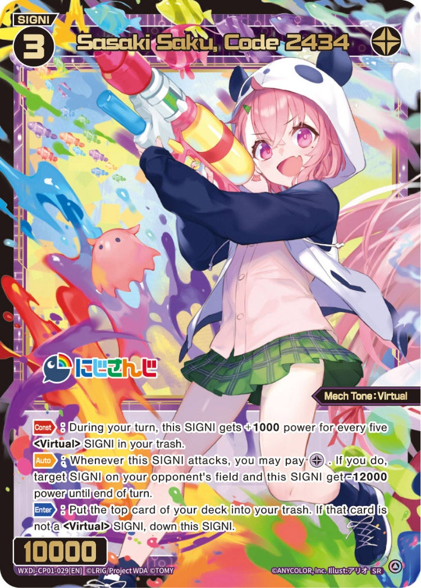

# Sasaki Saku, Code 2434

## Thông tin lá

| Trường | Giá trị |
| --- | --- |
| Mã in | WXDi-CP01-029[EN] |
| Set | WXDi-CP01[EN] |
| Số thứ tự | 029 |
| Loại thẻ | SIGNI |
| Vị trí | Main Deck |
| Số bản | — (set booster, không áp dụng) |
| Màu | Đen |
| Độ hiếm | SR,SRP |
| Minh họa | アリオ |
| Level | 3 |
| Limit | — |
| Power | 10000 |
| LRIG type / Class | Mech Tone：Virtual |
| Team / Master | — |
| Cost | — |
| Grow cost | — |
| Use timing | — |
| Life Burst | Không |

## Card text chính thức

[Constant]: During your turn, this SIGNI gets +1000 power for every five <Virtual> SIGNI in your trash.
[Auto]: Whenever this SIGNI attacks, you may pay {Black}. If you do, target SIGNI on your opponent's field and this SIGNI get -12000 power until end of turn.
[Enter]: Put the top card of your deck into your trash. If that card is not a <Virtual> SIGNI, down this SIGNI.

## Power text / Life Burst

—

## Ghi chú minh họa
Artist: アリオ. Ảnh SR được tải từ Card List tiếng Anh.

## FAQ chính thức

**Q. This SIGNI attacked, and resolved its [Auto] ability, this SIGNI's power reduced to zero or less. How is the attack handled?**
A. If this SIGNI's power is reduced to zero or less as a result of resolving its [Auto] ability when it attacks, it is vanished by Rule-based action. This SIGNI's attack is not processed (processing damage to your opponent or battle with the SIGNI in front of it).

**Q. Does the [Enter] ability have to be triggered?**
A. Yes, the [Enter] ability without cost must be triggered.

## Ảnh biến thể

- [SRP](../images/WXDi-CP01-029P-EN.jpg)

## Nguồn
[Card List/FAQ chính thức](https://www.takaratomy.co.jp/products/en.wixoss/card/card.html?card_no=WXDi-CP01-029%5BEN%5D ) · [Ảnh thẻ](https://www.takaratomy.co.jp/products/en.wixoss/card/thumb/WXDi-CP01-029%5BEN%5D.jpg)
