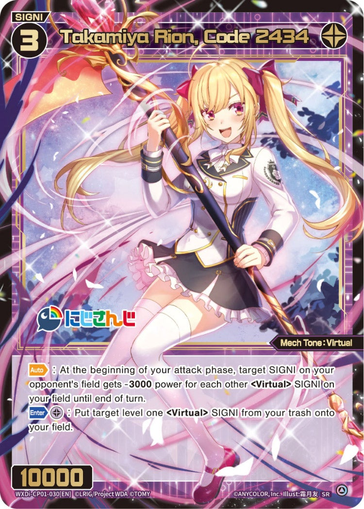

# Takamiya Rion, Code 2434

## Thông tin lá

| Trường | Giá trị |
| --- | --- |
| Mã in | WXDi-CP01-030[EN] |
| Set | WXDi-CP01[EN] |
| Số thứ tự | 030 |
| Loại thẻ | SIGNI |
| Vị trí | Main Deck |
| Số bản | — (set booster, không áp dụng) |
| Màu | Đen |
| Độ hiếm | SR,SRP |
| Minh họa | 霜月友 |
| Level | 3 |
| Limit | — |
| Power | 10000 |
| LRIG type / Class | Mech Tone：Virtual |
| Team / Master | — |
| Cost | — |
| Grow cost | — |
| Use timing | — |
| Life Burst | Không |

## Card text chính thức

[Auto]: At the beginning of your attack phase, target SIGNI on your opponent's field gets -3000 power for each other <Virtual> SIGNI on your field until end of turn.
[Enter] {Black}: Put target level one <Virtual> SIGNI from your trash onto your field.

## Power text / Life Burst

—

## Ghi chú minh họa
Artist: 霜月友. Ảnh SR được tải từ Card List tiếng Anh.

## FAQ chính thức

— (không có FAQ riêng cho mã này trên trang FAQ tiếng Anh.)

## Ảnh biến thể

- [SRP](../images/WXDi-CP01-030P-EN.jpg)

## Nguồn
[Card List/FAQ chính thức](https://www.takaratomy.co.jp/products/en.wixoss/card/card.html?card_no=WXDi-CP01-030%5BEN%5D ) · [Ảnh thẻ](https://www.takaratomy.co.jp/products/en.wixoss/card/thumb/WXDi-CP01-030%5BEN%5D.jpg)
