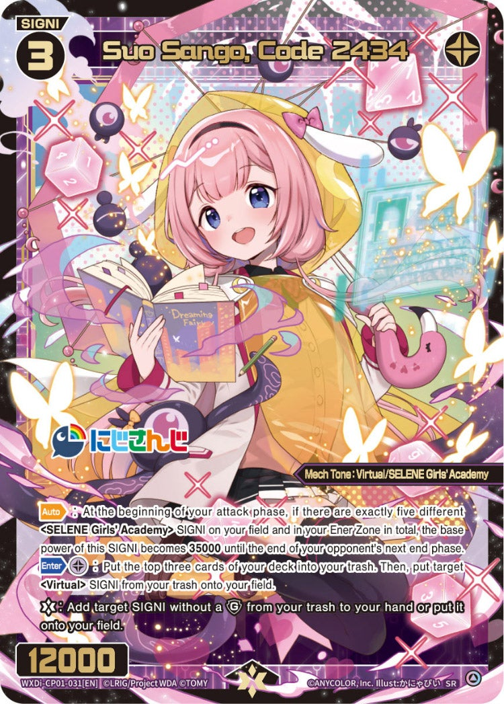

# Suo Sango, Code 2434

## Thông tin lá

| Trường | Giá trị |
| --- | --- |
| Mã in | WXDi-CP01-031[EN] |
| Set | WXDi-CP01[EN] |
| Số thứ tự | 031 |
| Loại thẻ | SIGNI |
| Vị trí | Main Deck |
| Số bản | — (set booster, không áp dụng) |
| Màu | Đen |
| Độ hiếm | SR,SRP |
| Minh họa | かにゃぴい |
| Level | 3 |
| Limit | — |
| Power | 12000 |
| LRIG type / Class | Mech Tone：Virtual/SELENE Girls' Academy |
| Team / Master | — |
| Cost | — |
| Grow cost | — |
| Use timing | — |
| Life Burst | Có |

## Card text chính thức

[Auto]: At the beginning of your attack phase, if there are exactly five different <SELENE Girls' Academy> SIGNI on your field and in your Ener Zone in total, the base power of this SIGNI becomes 35000 until the end of your opponent's next end phase.
[Enter] {Black}: Put the top three cards of your deck into your trash. Then, put target <Virtual> SIGNI from your trash onto your field.

## Power text / Life Burst

Add target SIGNI without a {Guard Icon} from your trash to your hand or put it onto your field.

## Ghi chú minh họa
Artist: かにゃぴい. Ảnh SR được tải từ Card List tiếng Anh.

## FAQ chính thức

**Q. How do I count if there are a total of five different <SELENE Girls' Academy> SIGNI?**
A. Check to see if there are five types SIGINI with different name that have <SELENE Girls' Academy> . This does not include cards placed under the SIGNI on your field or cards attached as [Acce] or [Charm].

## Ảnh biến thể

- [SRP](../images/WXDi-CP01-031P-EN.jpg)

## Nguồn
[Card List/FAQ chính thức](https://www.takaratomy.co.jp/products/en.wixoss/card/card.html?card_no=WXDi-CP01-031%5BEN%5D ) · [Ảnh thẻ](https://www.takaratomy.co.jp/products/en.wixoss/card/thumb/WXDi-CP01-031%5BEN%5D.jpg)
