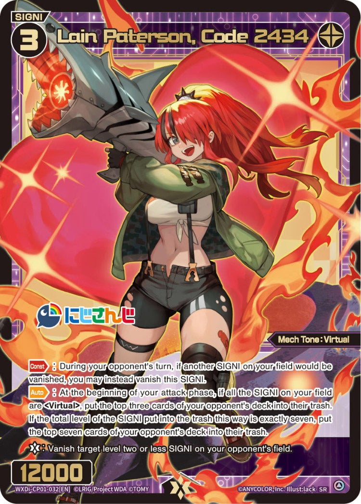

# Lain Paterson, Code 2434

## Thông tin lá

| Trường | Giá trị |
| --- | --- |
| Mã in | WXDi-CP01-032[EN] |
| Set | WXDi-CP01[EN] |
| Số thứ tự | 032 |
| Loại thẻ | SIGNI |
| Vị trí | Main Deck |
| Số bản | — (set booster, không áp dụng) |
| Màu | Đen |
| Độ hiếm | SR,SRP |
| Minh họa | lack |
| Level | 3 |
| Limit | — |
| Power | 12000 |
| LRIG type / Class | Mech Tone：Virtual |
| Team / Master | — |
| Cost | — |
| Grow cost | — |
| Use timing | — |
| Life Burst | Có |

## Card text chính thức

[Constant]: During your opponent's turn, if another SIGNI on your field would be vanished, you may instead vanish this SIGNI.
[Auto]: At the beginning of your attack phase, if all the SIGNI on your field are <Virtual>, put the top three cards of your opponent's deck into their trash. If the total level of the SIGNI put into the trash this way is exactly seven, put the top seven cards of your opponent's deck into their trash.

## Power text / Life Burst

Vanish target level two or less SIGNI on your opponent's field.

## Ghi chú minh họa
Artist: lack. Ảnh SR được tải từ Card List tiếng Anh.

## FAQ chính thức

**Q. When there are three SIGNI on my field, including this SIGNI, my opponent resolved the effect "Vanish all SIGNI". Can I keep the other two SIGNI on the field by this SIGNI's [Const] Ability?**
A. No. In that case, only one SIGNI can remain on your field. You choose which SIGNI to use the [Const] ability, and only that SIGNI remains on your field, then this SIGNI and the SIGNI you did not choose are vanished.

## Ảnh biến thể

- [SRP](../images/WXDi-CP01-032P-EN.jpg)

## Nguồn
[Card List/FAQ chính thức](https://www.takaratomy.co.jp/products/en.wixoss/card/card.html?card_no=WXDi-CP01-032%5BEN%5D ) · [Ảnh thẻ](https://www.takaratomy.co.jp/products/en.wixoss/card/thumb/WXDi-CP01-032%5BEN%5D.jpg)
