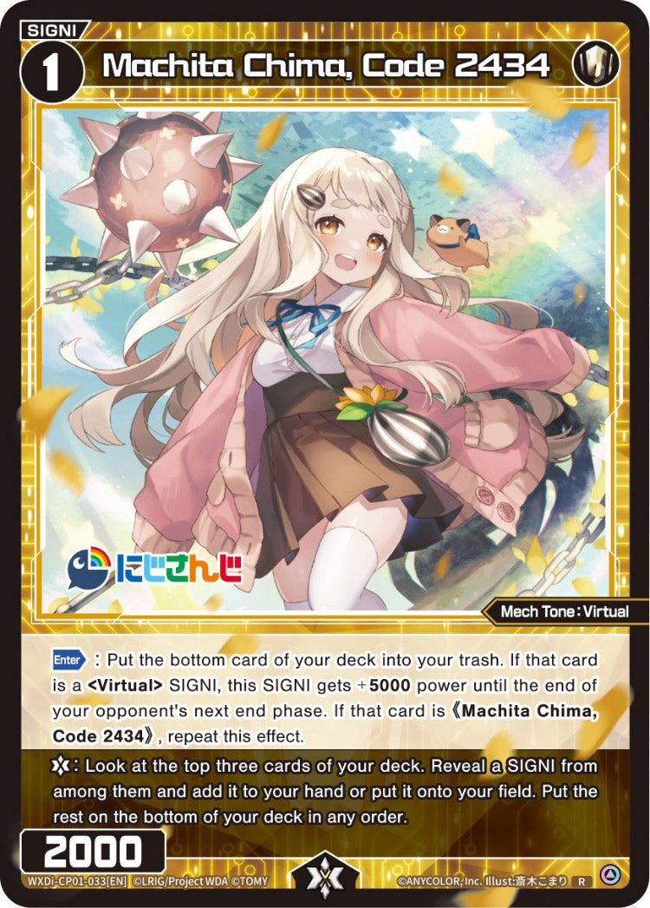

# Machita Chima, Code 2434

## Thông tin lá

| Trường | Giá trị |
| --- | --- |
| Mã in | WXDi-CP01-033[EN] |
| Set | WXDi-CP01[EN] |
| Số thứ tự | 033 |
| Loại thẻ | SIGNI |
| Vị trí | Main Deck |
| Số bản | — (set booster, không áp dụng) |
| Màu | Trắng |
| Độ hiếm | R,R(P) |
| Minh họa | 斎木こまり |
| Level | 1 |
| Limit | — |
| Power | 2000 |
| LRIG type / Class | Mech Tone：Virtual |
| Team / Master | — |
| Cost | — |
| Grow cost | — |
| Use timing | — |
| Life Burst | Có |

## Card text chính thức

[Enter]: Put the bottom card of your deck into your trash. If that card is a <Virtual> SIGNI, this SIGNI gets +5000 power until the end of your opponent's next end phase. If that card is 《Machita Chima, Code 2434》, repeat this effect.

## Power text / Life Burst

Look at the top three cards of your deck. Reveal a SIGNI from among them and add it to your hand or put it onto your field. Put the rest on the bottom of your deck in any order.

## Ghi chú minh họa
Artist: 斎木こまり. Ảnh R được tải từ Card List tiếng Anh.

## FAQ chính thức

**Q. Where does "repeat this effect" start to repeat its effect?**
A. The first of the  [Enter] ability starts from putting the bottom card of your deck into your trash. If there is another 《Machita Chima, Code 2434》 there, repeat the process further.

## Ảnh biến thể

- [R(P)](../images/WXDi-CP01-033P-EN.jpg)

## Nguồn
[Card List/FAQ chính thức](https://www.takaratomy.co.jp/products/en.wixoss/card/card.html?card_no=WXDi-CP01-033%5BEN%5D ) · [Ảnh thẻ](https://www.takaratomy.co.jp/products/en.wixoss/card/thumb/WXDi-CP01-033%5BEN%5D.jpg)
