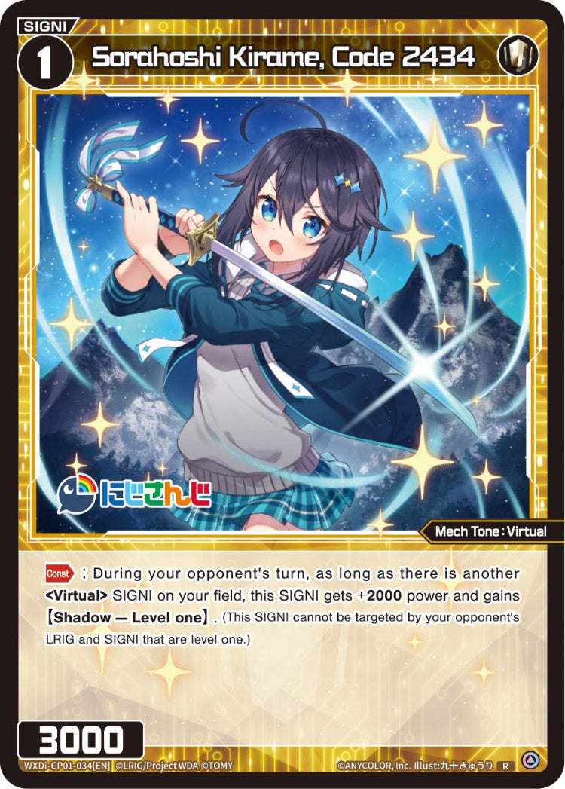

# Sorahoshi Kirame, Code 2434

## Thông tin lá

| Trường | Giá trị |
| --- | --- |
| Mã in | WXDi-CP01-034[EN] |
| Set | WXDi-CP01[EN] |
| Số thứ tự | 034 |
| Loại thẻ | SIGNI |
| Vị trí | Main Deck |
| Số bản | — (set booster, không áp dụng) |
| Màu | Trắng |
| Độ hiếm | R,R(P) |
| Minh họa | 九十きゅうり |
| Level | 1 |
| Limit | — |
| Power | 3000 |
| LRIG type / Class | Mech Tone：Virtual |
| Team / Master | — |
| Cost | — |
| Grow cost | — |
| Use timing | — |
| Life Burst | Không |

## Card text chính thức

[Constant]: During your opponent's turn, as long as there is another <Virtual> SIGNI on your field, this SIGNI gets +2000 power and gains 【Shadow — Level one】. (This SIGNI cannot be targeted by your opponent's LRIG and SIGNI that are level one.)

## Power text / Life Burst

—

## Ghi chú minh họa
Artist: 九十きゅうり. Ảnh R được tải từ Card List tiếng Anh.

## FAQ chính thức

— (không có FAQ riêng cho mã này trên trang FAQ tiếng Anh.)

## Ảnh biến thể

- [R(P)](../images/WXDi-CP01-034P-EN.jpg)

## Nguồn
[Card List/FAQ chính thức](https://www.takaratomy.co.jp/products/en.wixoss/card/card.html?card_no=WXDi-CP01-034%5BEN%5D ) · [Ảnh thẻ](https://www.takaratomy.co.jp/products/en.wixoss/card/thumb/WXDi-CP01-034%5BEN%5D.jpg)
