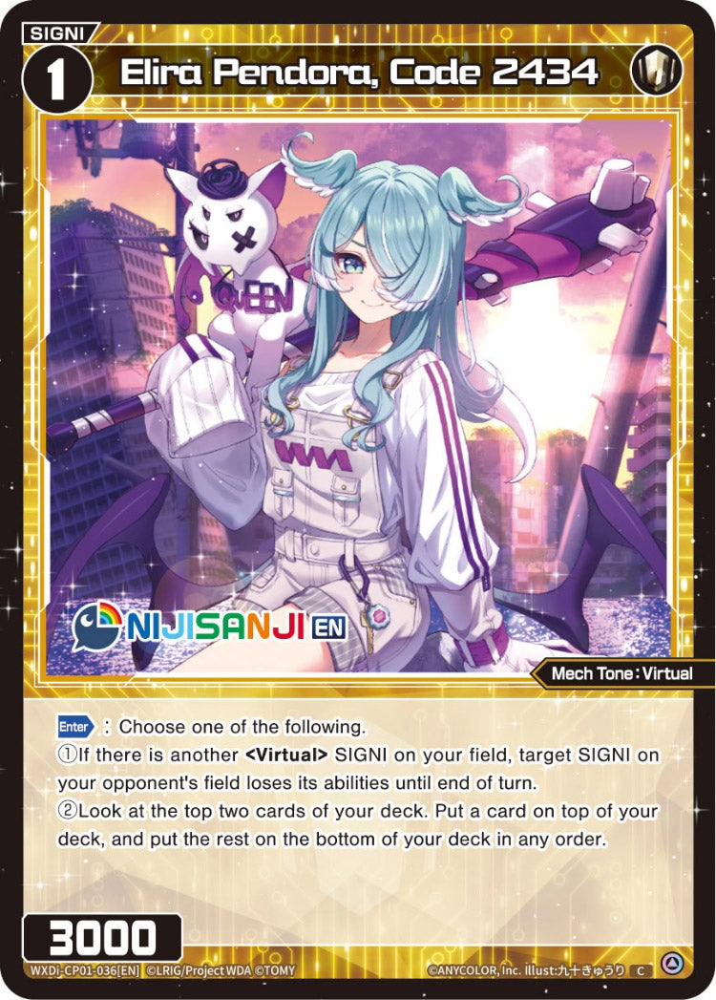

# Elira Pendora, Code 2434

## Thông tin lá

| Trường | Giá trị |
| --- | --- |
| Mã in | WXDi-CP01-036[EN] |
| Set | WXDi-CP01[EN] |
| Số thứ tự | 036 |
| Loại thẻ | SIGNI |
| Vị trí | Main Deck |
| Số bản | — (set booster, không áp dụng) |
| Màu | Trắng |
| Độ hiếm | C,C(P),ENR |
| Minh họa | 九十きゅうり |
| Level | 1 |
| Limit | — |
| Power | 3000 |
| LRIG type / Class | Mech Tone：Virtual |
| Team / Master | — |
| Cost | — |
| Grow cost | — |
| Use timing | — |
| Life Burst | Không |

## Card text chính thức

[Enter]: Choose one of the following.
①If there is another <Virtual> SIGNI on your field, target SIGNI on your opponent's field loses its abilities until end of turn.
②Look at the top two cards of your deck. Put a card on top of your deck, and put the rest on the bottom of your deck in any order.

## Power text / Life Burst

—

## Ghi chú minh họa
Artist: 九十きゅうり. Ảnh C được tải từ Card List tiếng Anh.

## FAQ chính thức

**Q. Can I choose (1) even if I have no other <Virtual> SIGNI on my field?**
A. Yes, you can. In that case, no target is chosen and no effect happens.

## Ảnh biến thể

- [C(P)](../images/WXDi-CP01-036P-EN.jpg)

## Nguồn
[Card List/FAQ chính thức](https://www.takaratomy.co.jp/products/en.wixoss/card/card.html?card_no=WXDi-CP01-036%5BEN%5D ) · [Ảnh thẻ](https://www.takaratomy.co.jp/products/en.wixoss/card/thumb/WXDi-CP01-036%5BEN%5D.jpg)
