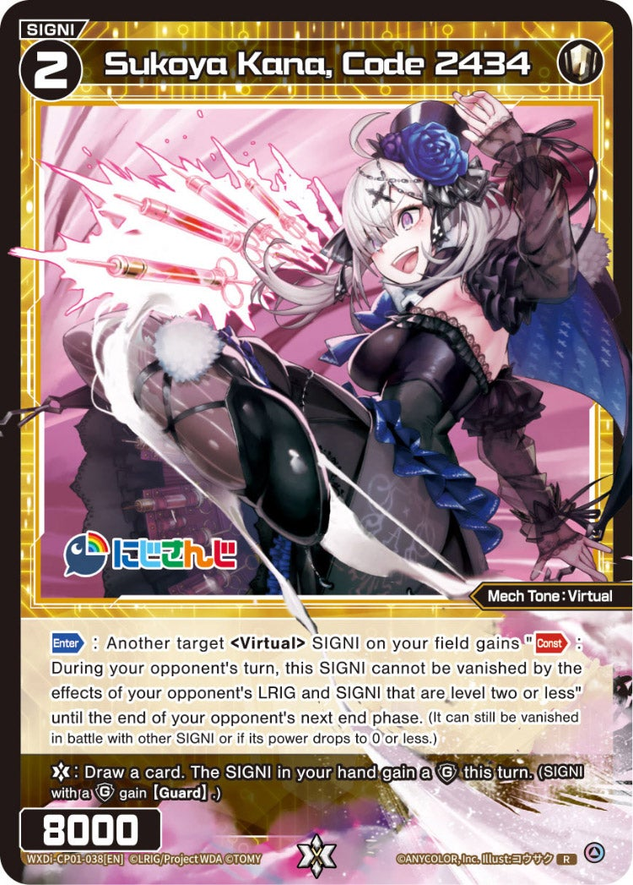

# Sukoya Kana, Code 2434

## Thông tin lá

| Trường | Giá trị |
| --- | --- |
| Mã in | WXDi-CP01-038[EN] |
| Set | WXDi-CP01[EN] |
| Số thứ tự | 038 |
| Loại thẻ | SIGNI |
| Vị trí | Main Deck |
| Số bản | — (set booster, không áp dụng) |
| Màu | Trắng |
| Độ hiếm | R,R(P) |
| Minh họa | コウサク |
| Level | 2 |
| Limit | — |
| Power | 8000 |
| LRIG type / Class | Mech Tone：Virtual |
| Team / Master | — |
| Cost | — |
| Grow cost | — |
| Use timing | — |
| Life Burst | Có |

## Card text chính thức

[Enter]: Another target <Virtual> SIGNI on your field gains "[Constant]: During your opponent's turn, this SIGNI cannot be vanished by the effects of your opponent's LRIG and SIGNI that are level two or less" until the end of your opponent's next end phase. (It can still be vanished in battle with other SIGNI or if its power drops to 0 or less.)

## Power text / Life Burst

Draw a card. The SIGNI in your hand gain a {Guard Icon} this turn. (SIGNI with a {Guard Icon} gain 【Guard】.)

## Ghi chú minh họa
Artist: コウサク. Ảnh R được tải từ Card List tiếng Anh.

## FAQ chính thức

— (không có FAQ riêng cho mã này trên trang FAQ tiếng Anh.)

## Ảnh biến thể

- [R(P)](../images/WXDi-CP01-038P-EN.jpg)

## Nguồn
[Card List/FAQ chính thức](https://www.takaratomy.co.jp/products/en.wixoss/card/card.html?card_no=WXDi-CP01-038%5BEN%5D ) · [Ảnh thẻ](https://www.takaratomy.co.jp/products/en.wixoss/card/thumb/WXDi-CP01-038%5BEN%5D.jpg)
