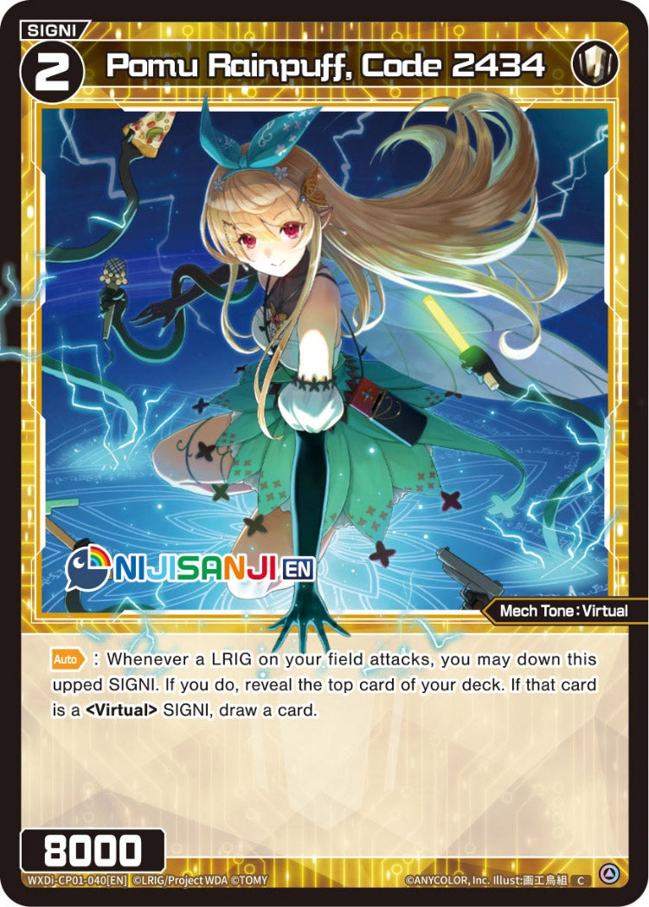

# Pomu Rainpuff, Code 2434

## Thông tin lá

| Trường | Giá trị |
| --- | --- |
| Mã in | WXDi-CP01-040[EN] |
| Set | WXDi-CP01[EN] |
| Số thứ tự | 040 |
| Loại thẻ | SIGNI |
| Vị trí | Main Deck |
| Số bản | — (set booster, không áp dụng) |
| Màu | Trắng |
| Độ hiếm | C,C(P),ENR |
| Minh họa | 画工鳥組 |
| Level | 2 |
| Limit | — |
| Power | 8000 |
| LRIG type / Class | Mech Tone：Virtual |
| Team / Master | — |
| Cost | — |
| Grow cost | — |
| Use timing | — |
| Life Burst | Không |

## Card text chính thức

[Auto]: Whenever a LRIG on your field attacks, you may down this upped SIGNI. If you do, reveal the top card of your deck. If that card is a <Virtual> SIGNI, draw a card.

## Power text / Life Burst

—

## Ghi chú minh họa
Artist: 画工鳥組. Ảnh C được tải từ Card List tiếng Anh.

## FAQ chính thức

— (không có FAQ riêng cho mã này trên trang FAQ tiếng Anh.)

## Ảnh biến thể

- [C(P)](../images/WXDi-CP01-040P-EN.jpg)

## Nguồn
[Card List/FAQ chính thức](https://www.takaratomy.co.jp/products/en.wixoss/card/card.html?card_no=WXDi-CP01-040%5BEN%5D ) · [Ảnh thẻ](https://www.takaratomy.co.jp/products/en.wixoss/card/thumb/WXDi-CP01-040%5BEN%5D.jpg)
