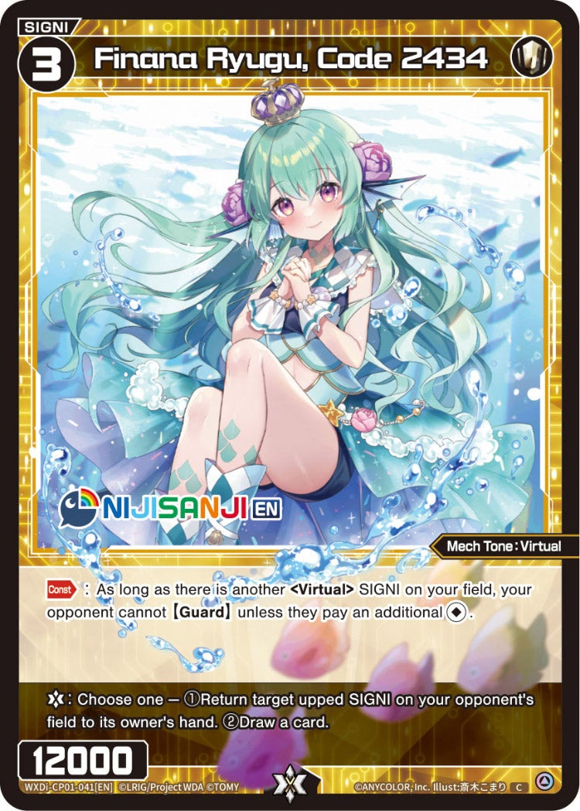

# Finana Ryugu, Code 2434

## Thông tin lá

| Trường | Giá trị |
| --- | --- |
| Mã in | WXDi-CP01-041[EN] |
| Set | WXDi-CP01[EN] |
| Số thứ tự | 041 |
| Loại thẻ | SIGNI |
| Vị trí | Main Deck |
| Số bản | — (set booster, không áp dụng) |
| Màu | Trắng |
| Độ hiếm | C,C(P),ENR |
| Minh họa | 斎木こまり |
| Level | 3 |
| Limit | — |
| Power | 12000 |
| LRIG type / Class | Mech Tone：Virtual |
| Team / Master | — |
| Cost | — |
| Grow cost | — |
| Use timing | — |
| Life Burst | Có |

## Card text chính thức

[Constant]: As long as there is another <Virtual> SIGNI on your field, your opponent cannot 【Guard】 unless they pay an additional {Colorless}.

## Power text / Life Burst

Choose one — ①Return target upped SIGNI on your opponent's field to its owner's hand. ②Draw a card.

## Ghi chú minh họa
Artist: 斎木こまり. Ảnh C được tải từ Card List tiếng Anh.

## FAQ chính thức

**Q. If there are two 《Finana Ryugu, Code 2434》 on my field, how many cost additionally must my opponent pay for using [Guard]?**
A. From the perspective of each 《Finana Ryugu, Code 2434》, the other is another <Virtual> SIGNI, so their [Const] abilities are applied. And their respective [Const] abilities are overlapped, so your opponent cannot use [Guard] unless they pay an additional {colorless} {colorless}.

## Ảnh biến thể

- [C(P)](../images/WXDi-CP01-041P-EN.jpg)

## Nguồn
[Card List/FAQ chính thức](https://www.takaratomy.co.jp/products/en.wixoss/card/card.html?card_no=WXDi-CP01-041%5BEN%5D ) · [Ảnh thẻ](https://www.takaratomy.co.jp/products/en.wixoss/card/thumb/WXDi-CP01-041%5BEN%5D.jpg)
