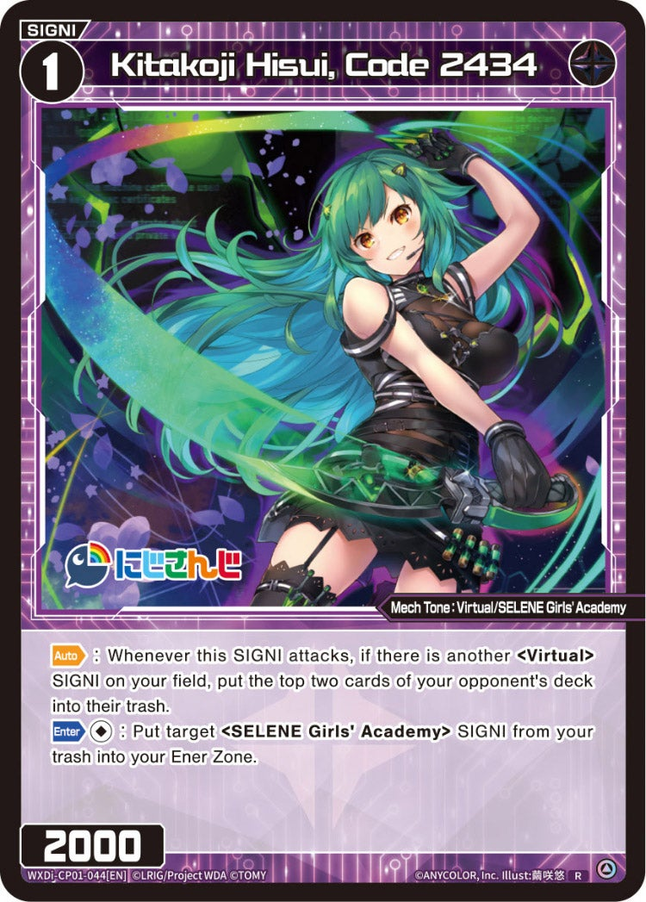

# Kitakoji Hisui, Code 2434

## Thông tin lá

| Trường | Giá trị |
| --- | --- |
| Mã in | WXDi-CP01-044[EN] |
| Set | WXDi-CP01[EN] |
| Số thứ tự | 044 |
| Loại thẻ | SIGNI |
| Vị trí | Main Deck |
| Số bản | — (set booster, không áp dụng) |
| Màu | Đen |
| Độ hiếm | R,R(P) |
| Minh họa | 繭咲悠 |
| Level | 1 |
| Limit | — |
| Power | 2000 |
| LRIG type / Class | Mech Tone：Virtual/SELENE Girls' Academy |
| Team / Master | — |
| Cost | — |
| Grow cost | — |
| Use timing | — |
| Life Burst | Không |

## Card text chính thức

[Auto]: Whenever this SIGNI attacks, if there is another <Virtual> SIGNI on your field, put the top two cards of your opponent's deck into their trash.
[Enter] {Colorless}: Put target <SELENE Girls' Academy> SIGNI from your trash into your Ener Zone.

## Power text / Life Burst

—

## Ghi chú minh họa
Artist: 繭咲悠. Ảnh R được tải từ Card List tiếng Anh.

## FAQ chính thức

**Q. Can I put a card paid for as the cost of the [Enter] ability directly into the Ener zone by this effect?**
A. Yes, it is possible. After paying the cost of the [Enter] ability, target a card that meets the conditions of your trash.

## Ảnh biến thể

- [R(P)](../images/WXDi-CP01-044P-EN.jpg)

## Nguồn
[Card List/FAQ chính thức](https://www.takaratomy.co.jp/products/en.wixoss/card/card.html?card_no=WXDi-CP01-044%5BEN%5D ) · [Ảnh thẻ](https://www.takaratomy.co.jp/products/en.wixoss/card/thumb/WXDi-CP01-044%5BEN%5D.jpg)
