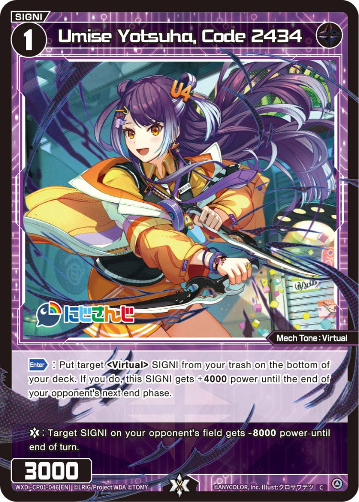

# Umise Yotsuha, Code 2434

## Thông tin lá

| Trường | Giá trị |
| --- | --- |
| Mã in | WXDi-CP01-046[EN] |
| Set | WXDi-CP01[EN] |
| Số thứ tự | 046 |
| Loại thẻ | SIGNI |
| Vị trí | Main Deck |
| Số bản | — (set booster, không áp dụng) |
| Màu | Đen |
| Độ hiếm | C,C(P) |
| Minh họa | クロサワテツ |
| Level | 1 |
| Limit | — |
| Power | 3000 |
| LRIG type / Class | Mech Tone：Virtual |
| Team / Master | — |
| Cost | — |
| Grow cost | — |
| Use timing | — |
| Life Burst | Có |

## Card text chính thức

[Enter]: Put target <Virtual> SIGNI from your trash on the bottom of your deck. If you do, this SIGNI gets +4000 power until the end of your opponent's next end phase.

## Power text / Life Burst

Target SIGNI on your opponent's field gets -8000 power until end of turn.

## Ghi chú minh họa
Artist: クロサワテツ. Ảnh C được tải từ Card List tiếng Anh.

## FAQ chính thức

— (không có FAQ riêng cho mã này trên trang FAQ tiếng Anh.)

## Ảnh biến thể

- [C(P)](../images/WXDi-CP01-046P-EN.jpg)

## Nguồn
[Card List/FAQ chính thức](https://www.takaratomy.co.jp/products/en.wixoss/card/card.html?card_no=WXDi-CP01-046%5BEN%5D ) · [Ảnh thẻ](https://www.takaratomy.co.jp/products/en.wixoss/card/thumb/WXDi-CP01-046%5BEN%5D.jpg)
