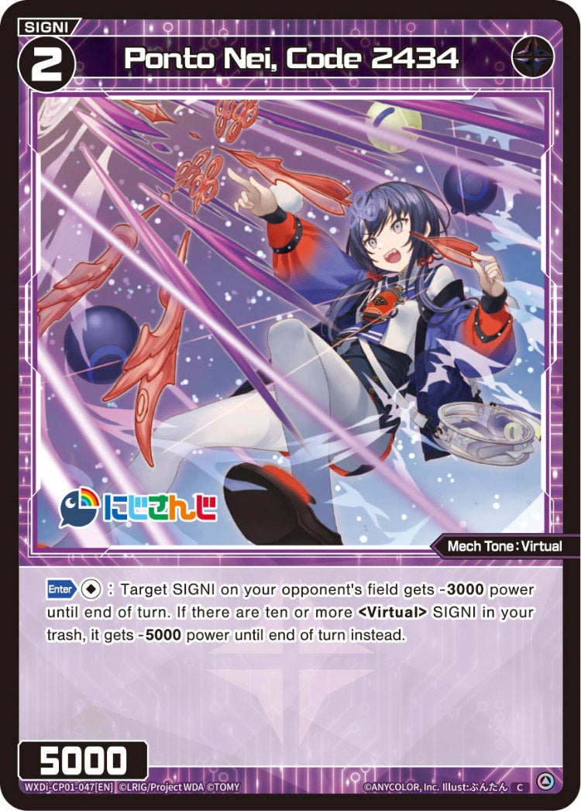

# Ponto Nei, Code 2434

## Thông tin lá

| Trường | Giá trị |
| --- | --- |
| Mã in | WXDi-CP01-047[EN] |
| Set | WXDi-CP01[EN] |
| Số thứ tự | 047 |
| Loại thẻ | SIGNI |
| Vị trí | Main Deck |
| Số bản | — (set booster, không áp dụng) |
| Màu | Đen |
| Độ hiếm | C,C(P) |
| Minh họa | ぶんたん |
| Level | 2 |
| Limit | — |
| Power | 5000 |
| LRIG type / Class | Mech Tone：Virtual |
| Team / Master | — |
| Cost | — |
| Grow cost | — |
| Use timing | — |
| Life Burst | Không |

## Card text chính thức

[Enter] {Colorless}: Target SIGNI on your opponent's field gets -3000 power until end of turn. If there are ten or more <Virtual> SIGNI in your trash, it gets -5000 power until end of turn instead.

## Power text / Life Burst

—

## Ghi chú minh họa
Artist: ぶんたん. Ảnh C được tải từ Card List tiếng Anh.

## FAQ chính thức

— (không có FAQ riêng cho mã này trên trang FAQ tiếng Anh.)

## Ảnh biến thể

- [C(P)](../images/WXDi-CP01-047P-EN.jpg)

## Nguồn
[Card List/FAQ chính thức](https://www.takaratomy.co.jp/products/en.wixoss/card/card.html?card_no=WXDi-CP01-047%5BEN%5D ) · [Ảnh thẻ](https://www.takaratomy.co.jp/products/en.wixoss/card/thumb/WXDi-CP01-047%5BEN%5D.jpg)
