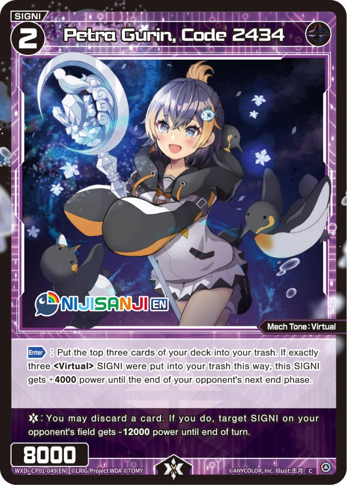

# Petra Gurin, Code 2434

## Thông tin lá

| Trường | Giá trị |
| --- | --- |
| Mã in | WXDi-CP01-049[EN] |
| Set | WXDi-CP01[EN] |
| Số thứ tự | 049 |
| Loại thẻ | SIGNI |
| Vị trí | Main Deck |
| Số bản | — (set booster, không áp dụng) |
| Màu | Đen |
| Độ hiếm | C,C(P),ENR |
| Minh họa | 志月 |
| Level | 2 |
| Limit | — |
| Power | 8000 |
| LRIG type / Class | Mech Tone：Virtual |
| Team / Master | — |
| Cost | — |
| Grow cost | — |
| Use timing | — |
| Life Burst | Có |

## Card text chính thức

[Enter]: Put the top three cards of your deck into your trash. If exactly three <Virtual> SIGNI were put into your trash this way, this SIGNI gets +4000 power until the end of your opponent's next end phase.

## Power text / Life Burst

You may discard a card. If you do, target SIGNI on your opponent's field gets -12000 power until end of turn.

## Ghi chú minh họa
Artist: 志月. Ảnh C được tải từ Card List tiếng Anh.

## FAQ chính thức

**Q. What happens if there are two or less cards in my deck when the [Enter] ability is triggered?**
A. In that case, put those two or less cards into your trash and the effect ends. Since three <Virtual> SIGNI are not put into your trash in this way, they do not get +4000 power, and since your deck is zero cards,  you refresh your deck.

## Ảnh biến thể

- [C(P)](../images/WXDi-CP01-049P-EN.jpg)

## Nguồn
[Card List/FAQ chính thức](https://www.takaratomy.co.jp/products/en.wixoss/card/card.html?card_no=WXDi-CP01-049%5BEN%5D ) · [Ảnh thẻ](https://www.takaratomy.co.jp/products/en.wixoss/card/thumb/WXDi-CP01-049%5BEN%5D.jpg)
