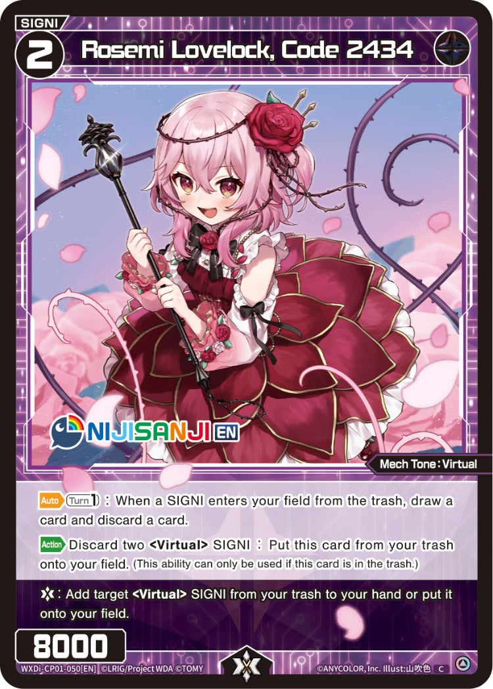

# Rosemi Lovelock, Code 2434

## Thông tin lá

| Trường | Giá trị |
| --- | --- |
| Mã in | WXDi-CP01-050[EN] |
| Set | WXDi-CP01[EN] |
| Số thứ tự | 050 |
| Loại thẻ | SIGNI |
| Vị trí | Main Deck |
| Số bản | — (set booster, không áp dụng) |
| Màu | Đen |
| Độ hiếm | C,C(P),ENR |
| Minh họa | 山吹色 |
| Level | 2 |
| Limit | — |
| Power | 8000 |
| LRIG type / Class | Mech Tone：Virtual |
| Team / Master | — |
| Cost | — |
| Grow cost | — |
| Use timing | — |
| Life Burst | Có |

## Card text chính thức

[Auto] {1/Turn}: When a SIGNI enters your field from the trash, draw a card and discard a card.

[Action] Discard two <Virtual> SIGNI: Put this card from your trash onto your field. (This ability can only be used if this card is in the trash.)

## Power text / Life Burst

Add target <Virtual> SIGNI from your trash to your hand or put it onto your field.

## Ghi chú minh họa
Artist: 山吹色. Ảnh C được tải từ Card List tiếng Anh.

## FAQ chính thức

**Q. If this SIGNI is put on my field from my trash by the [Action] Ability, is the [Auto] Ability triggered?**
A. Yes, it is triggered.

## Ảnh biến thể

- [C(P)](../images/WXDi-CP01-050P-EN.jpg)

## Nguồn
[Card List/FAQ chính thức](https://www.takaratomy.co.jp/products/en.wixoss/card/card.html?card_no=WXDi-CP01-050%5BEN%5D ) · [Ảnh thẻ](https://www.takaratomy.co.jp/products/en.wixoss/card/thumb/WXDi-CP01-050%5BEN%5D.jpg)
