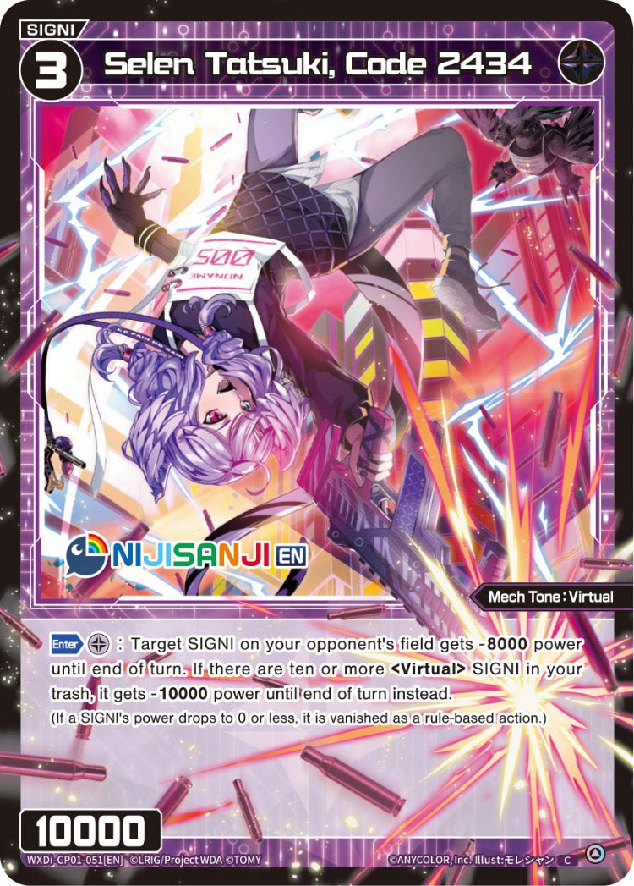

# Selen Tatsuki, Code 2434

## Thông tin lá

| Trường | Giá trị |
| --- | --- |
| Mã in | WXDi-CP01-051[EN] |
| Set | WXDi-CP01[EN] |
| Số thứ tự | 051 |
| Loại thẻ | SIGNI |
| Vị trí | Main Deck |
| Số bản | — (set booster, không áp dụng) |
| Màu | Đen |
| Độ hiếm | C,C(P),ENR |
| Minh họa | モレシャン |
| Level | 3 |
| Limit | — |
| Power | 10000 |
| LRIG type / Class | Mech Tone：Virtual |
| Team / Master | — |
| Cost | — |
| Grow cost | — |
| Use timing | — |
| Life Burst | Không |

## Card text chính thức

[Enter] {Black}: Target SIGNI on your opponent's field gets -8000 power until end of turn. If there are ten or more <Virtual> SIGNI in your trash, it gets -10000 power until end of turn instead.
(If a SIGNI's power drops to 0 or less, it is vanished as a rule-based action.)

## Power text / Life Burst

—

## Ghi chú minh họa
Artist: モレシャン. Ảnh C được tải từ Card List tiếng Anh.

## FAQ chính thức

**Q. When checking whether there are ten <Virtual> SIGNI in my trash, does it include the cards paid for this [Enter] ability?**
A. Yes, card paid for as the cost of [Enter] ability is included and counted.

## Ảnh biến thể

- [C(P)](../images/WXDi-CP01-051P-EN.jpg)

## Nguồn
[Card List/FAQ chính thức](https://www.takaratomy.co.jp/products/en.wixoss/card/card.html?card_no=WXDi-CP01-051%5BEN%5D ) · [Ảnh thẻ](https://www.takaratomy.co.jp/products/en.wixoss/card/thumb/WXDi-CP01-051%5BEN%5D.jpg)
