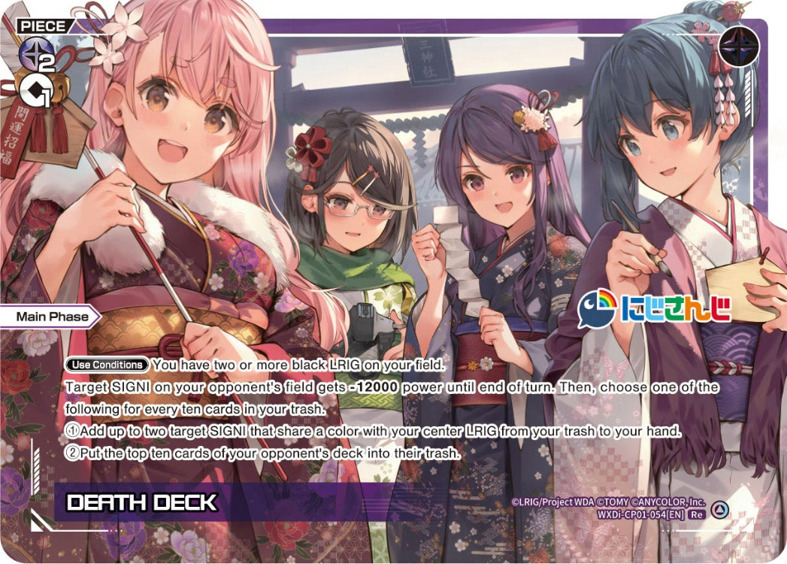

# DEATH DECK

## Thông tin lá

| Trường | Giá trị |
| --- | --- |
| Mã in | WXDi-CP01-054[EN] |
| Set | WXDi-CP01[EN] |
| Số thứ tự | 054 |
| Loại thẻ | PIECE |
| Vị trí | LRIG Deck |
| Số bản | — (set booster, không áp dụng) |
| Màu | Đen |
| Độ hiếm | Re |
| Minh họa | — |
| Level | — |
| Limit | — |
| Power | 0 |
| LRIG type / Class | — |
| Team / Master | — |
| Cost | 《B》×２
《C》×１ |
| Grow cost | — |
| Use timing | Main Phase |
| Life Burst | Không |

## Card text chính thức

[Use Conditions] You have two or more black LRIG on your field.

Target SIGNI on your opponent's field gets -12000 power until end of turn. Then, choose one of the following for every ten cards in your trash.
①Add up to two target SIGNI that share a color with your center LRIG from your trash to your hand.
②Put the top ten cards of your opponent's deck into their trash.

## Power text / Life Burst

—

## Ghi chú minh họa
Artist: —. Ảnh Re được tải từ Card List tiếng Anh.

## FAQ chính thức

— (không có FAQ riêng cho mã này trên trang FAQ tiếng Anh.)

## Nguồn
[Card List/FAQ chính thức](https://www.takaratomy.co.jp/products/en.wixoss/card/card.html?card_no=WXDi-CP01-054%5BEN%5D ) · [Ảnh thẻ](https://www.takaratomy.co.jp/products/en.wixoss/card/thumb/WXDi-CP01-054%5BEN%5D.jpg)
