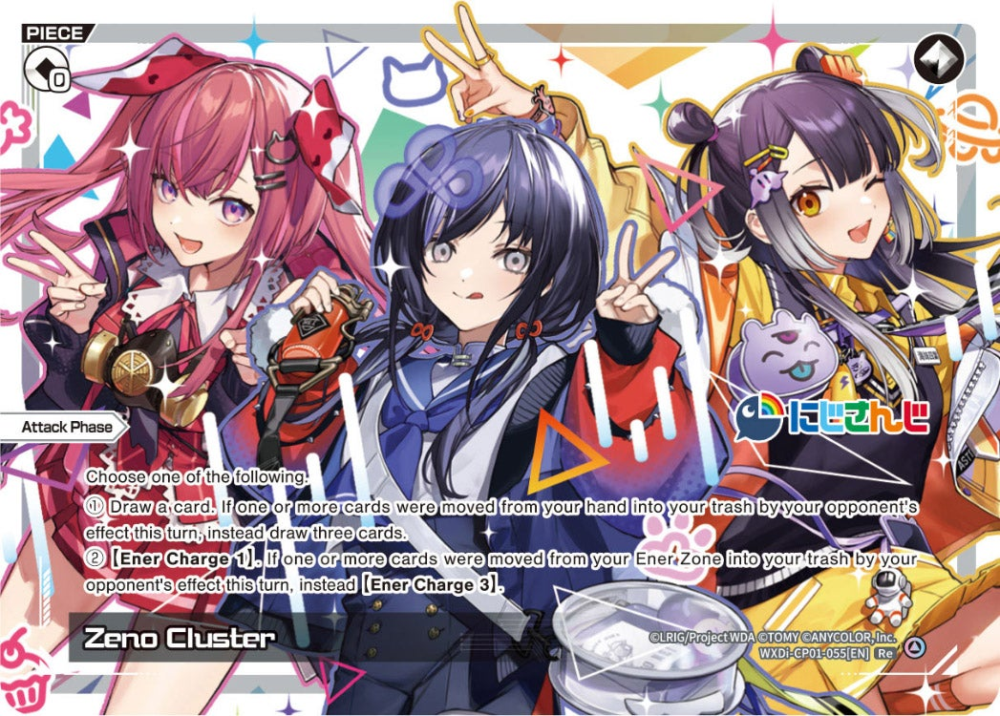

# Zeno Cluster

## Thông tin lá

| Trường | Giá trị |
| --- | --- |
| Mã in | WXDi-CP01-055[EN] |
| Set | WXDi-CP01[EN] |
| Số thứ tự | 055 |
| Loại thẻ | PIECE |
| Vị trí | LRIG Deck |
| Số bản | — (set booster, không áp dụng) |
| Màu | Không màu |
| Độ hiếm | Re |
| Minh họa | — |
| Level | — |
| Limit | — |
| Power | 0 |
| LRIG type / Class | — |
| Team / Master | — |
| Cost | 《C》×０ |
| Grow cost | — |
| Use timing | Attack Phase |
| Life Burst | Không |

## Card text chính thức

Choose one of the following.
①Draw a card. If one or more cards were moved from your hand into your trash by your opponent's effect this turn, instead draw three cards.
②【Ener Charge 1】. If one or more cards were moved from your Ener Zone into your trash by your opponent's effect this turn, instead 【Ener Charge 3】.

## Power text / Life Burst

—

## Ghi chú minh họa
Artist: —. Ảnh Re được tải từ Card List tiếng Anh.

## FAQ chính thức

— (không có FAQ riêng cho mã này trên trang FAQ tiếng Anh.)

## Nguồn
[Card List/FAQ chính thức](https://www.takaratomy.co.jp/products/en.wixoss/card/card.html?card_no=WXDi-CP01-055%5BEN%5D ) · [Ảnh thẻ](https://www.takaratomy.co.jp/products/en.wixoss/card/thumb/WXDi-CP01-055%5BEN%5D.jpg)
