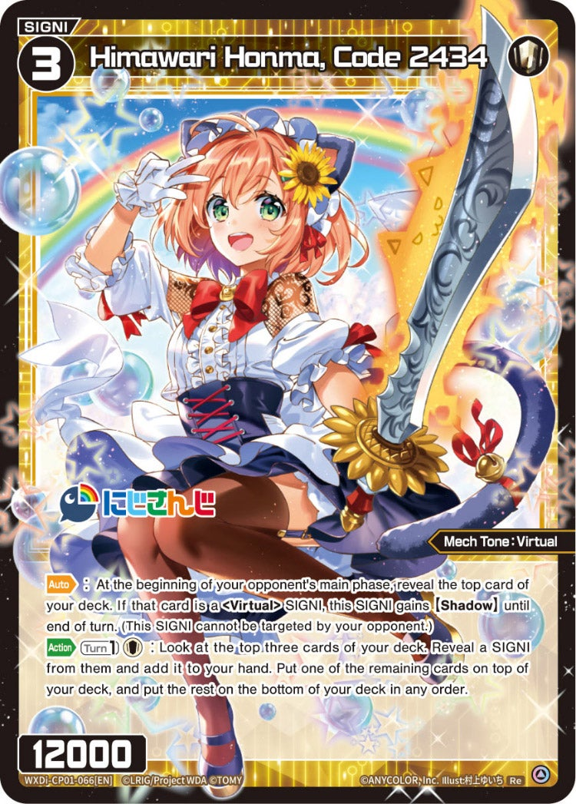

# Himawari Honma, Code 2434

## Thông tin lá

| Trường | Giá trị |
| --- | --- |
| Mã in | WXDi-CP01-066[EN] |
| Set | WXDi-CP01[EN] |
| Số thứ tự | 066 |
| Loại thẻ | SIGNI |
| Vị trí | Main Deck |
| Số bản | — (set booster, không áp dụng) |
| Màu | Trắng |
| Độ hiếm | Re |
| Minh họa | 村上ゆいち |
| Level | 3 |
| Limit | — |
| Power | 12000 |
| LRIG type / Class | Mech Tone：Virtual |
| Team / Master | — |
| Cost | — |
| Grow cost | — |
| Use timing | — |
| Life Burst | Không |

## Card text chính thức

[Auto]: At the beginning of your opponent's main phase, reveal the top card of your deck. If that card is a <Virtual> SIGNI, this SIGNI gains 【Shadow】 until end of turn. (This SIGNI cannot be targeted by your opponent.)
[Action] {1/Turn} {White}: Look at the top three cards of your deck. Reveal a SIGNI from them and add it to your hand. Put one of the remaining cards on top of your deck, and put the rest on the bottom of your deck in any order.

## Power text / Life Burst

—

## Ghi chú minh họa
Artist: 村上ゆいち. Ảnh Re được tải từ Card List tiếng Anh.

## FAQ chính thức

— (không có FAQ riêng cho mã này trên trang FAQ tiếng Anh.)

## Nguồn
[Card List/FAQ chính thức](https://www.takaratomy.co.jp/products/en.wixoss/card/card.html?card_no=WXDi-CP01-066%5BEN%5D ) · [Ảnh thẻ](https://www.takaratomy.co.jp/products/en.wixoss/card/thumb/WXDi-CP01-066%5BEN%5D.jpg)
