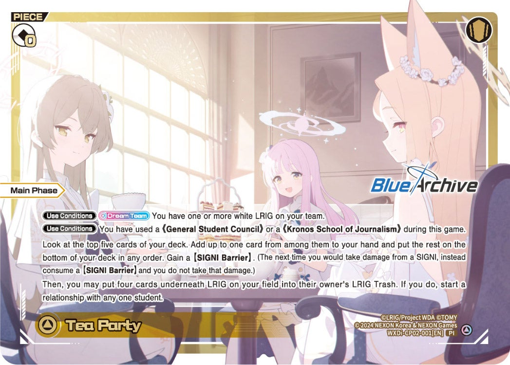

# Tea Party

## Thông tin lá

| Trường | Giá trị |
| --- | --- |
| Mã in | WXDi-CP02-001[EN] |
| Set | WXDi-CP02[EN] |
| Số thứ tự | 001 |
| Loại thẻ | PIECE |
| Vị trí | LRIG Deck |
| Số bản | — (set booster, không áp dụng) |
| Màu | Trắng |
| Độ hiếm | PI,LRP |
| Minh họa | — |
| Level | — |
| Limit | — |
| Power | 0 |
| LRIG type / Class | — |
| Team / Master | — |
| Cost | 《C》×０ |
| Grow cost | — |
| Use timing | Main Phase |
| Life Burst | Không |

## Card text chính thức

[Use Conditions] [Dream Team] You have one or more white LRIG on your team.
[Use Conditions] You have used a 《General Student Council》 or a 《Kronos School of Journalism》 during this game.

Look at the top five cards of your deck. Add up to one card from among them to your hand and put the rest on the bottom of your deck in any order. Gain a 【SIGNI Barrier】. (The next time you would take damage from a SIGNI, instead consume a 【SIGNI Barrier】 and you do not take that damage.)
Then, you may put four cards underneath LRIG on your field into their owner's LRIG Trash. If you do, start a relationship with any one student.

## Power text / Life Burst

—

## Ghi chú minh họa
Artist: —. Ảnh PI được tải từ Card List tiếng Anh.

## FAQ chính thức

**Q. Do both [Use Conditions] need to be met?**
A. Yes, both must be met to use this PIECE.

**Q. What does it mean to “start a relationship with any one student”?**
A. Declare the name of a student from Blue Archive DIVA and start a relationship with that student. Cards of students who have started a relationship will enable the [Relationship] ability. Please note that you are declaring the student's name, not the card name. If you have more than one ability to start a relationship, you will start a relationship with another student for that amount of time, and it will not be lost.
For example, if you declare “Ajitani Hifumi,” you will get 《Ajitani Hifumi [Help Me, Peroro!]》 and 《Ajitani Hifumi (Swimsuit)》 will both be enabled.
Please use the tokens include in the packs or the [Relationship] chips distributed at official events as a marker of who you started a relationship for. You can also prepare your own markers as long as they are not mixed with other cards and are not designed in a way that is inconvenient for the game.

**Q. May I choose not to consume 【SIGNI Barrier】 when taking damage?**
A. No, you cannot. If you take damage, you must consume it. However, if there are other effects that prevent you from taking damage (such as Enter ability of 《Bang =Da Capo=》), you can choose which one prevents you from doing so.

**Q. Do I lose 【SIGNI Barrier】 when the LRIG loses its abilities?**
A. No, you don't lose them because they are not abilities that the LRIG is gaining.

**Q. May I prevent the damage from the attack of a SIGNI with [Double Crush] with one [SIGNI Barrier]?**
A. Yes, it can. [Double Crush] is an effect that increases the number of cards you can crush when you deal damage by attacking to two, but still only deals damage once. [SIGNI Barrier] can prevent that one time.

**Q. May my opponent's SIGNI with 【S Lancer】 be prevented by 【SIGNI Barrier】?**
A. If you have no Life Cloth, the effect of 【S Lancer】 causing damage can be prevented by 【SIGNI Barrier】. If you have Life Cloth, 【S Lancer】 cannot be prevented because its effect is to crush your Life Cloth as well as 【Lancer】.

## Ảnh biến thể

- [LRP](../images/WXDi-CP02-001P-EN.jpg)

## Nguồn
[Card List/FAQ chính thức](https://www.takaratomy.co.jp/products/en.wixoss/card/card.html?card_no=WXDi-CP02-001%5BEN%5D ) · [Ảnh thẻ](https://www.takaratomy.co.jp/products/en.wixoss/card/thumb/WXDi-CP02-001%5BEN%5D.jpg)
