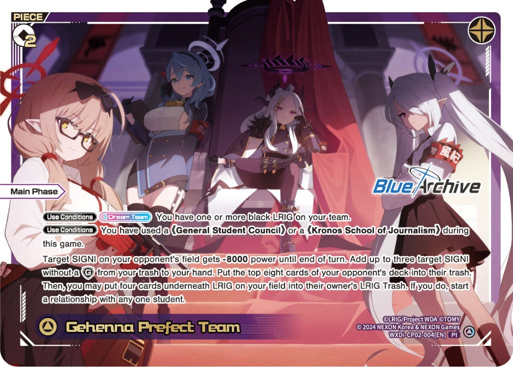

# Gehenna Prefect Team

## Thông tin lá

| Trường | Giá trị |
| --- | --- |
| Mã in | WXDi-CP02-004[EN] |
| Set | WXDi-CP02[EN] |
| Số thứ tự | 004 |
| Loại thẻ | PIECE |
| Vị trí | LRIG Deck |
| Số bản | — (set booster, không áp dụng) |
| Màu | Đen |
| Độ hiếm | PI,LRP |
| Minh họa | — |
| Level | — |
| Limit | — |
| Power | 0 |
| LRIG type / Class | — |
| Team / Master | — |
| Cost | 《C》×２ |
| Grow cost | — |
| Use timing | Main Phase |
| Life Burst | Không |

## Card text chính thức

[Use Conditions] [Dream Team] You have one or more black LRIG on your team.
[Use Conditions] You have used a 《General Student Council》 or a 《Kronos School of Journalism》 during this game.

Target SIGNI on your opponent's field gets -8000 power until end of turn. Add up to three target SIGNI without a {Guard Icon} from your trash to your hand. Put the top eight cards of your opponent's deck into their trash.
Then, you may put four cards underneath LRIG on your field into their owner's LRIG Trash. If you do, start a relationship with any one student.

## Power text / Life Burst

—

## Ghi chú minh họa
Artist: —. Ảnh PI được tải từ Card List tiếng Anh.

## FAQ chính thức

**Q. Do both [Use Conditions] need to be met?**
A. Yes, both must be met to use this PIECE.

**Q. What does it mean to “start a relationship with any one student”?**
A. Declare the name of a student from Blue Archive DIVA and start a relationship with that student. Cards of students who have start a relationship will enable the [Relationship] ability. Please note that you are declaring the student's name, not the card name. If you have more than one ability to start a relationship, you will start a relationship with another student for that amount of time, and it will not be lost.
For example, if you declare “Ajitani Hifumi,” you will get 《Ajitani Hifumi [Help Me, Peroro!]》 and 《Ajitani Hifumi (Swimsuit)》 will both be enabled.
Please use the tokens include in the packs or the [Relationship] chips distributed at official events as a marker of who you started a relationship. You can also prepare your own markers as long as they are not mixed with other cards and are not designed in a way that is inconvenient for the game.

**Q. May I use this PIECE even if my opponent does not have a single SIGNI on thier field?**
A. Yes, you can. In that case, the first effect is skipped and subsequent effects are resolved in order.

## Ảnh biến thể

- [LRP](../images/WXDi-CP02-004P-EN.jpg)

## Nguồn
[Card List/FAQ chính thức](https://www.takaratomy.co.jp/products/en.wixoss/card/card.html?card_no=WXDi-CP02-004%5BEN%5D ) · [Ảnh thẻ](https://www.takaratomy.co.jp/products/en.wixoss/card/thumb/WXDi-CP02-004%5BEN%5D.jpg)
