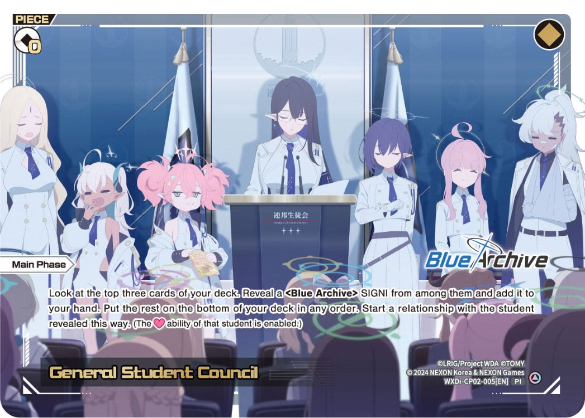

# General Student Council

## Thông tin lá

| Trường | Giá trị |
| --- | --- |
| Mã in | WXDi-CP02-005[EN] |
| Set | WXDi-CP02[EN] |
| Số thứ tự | 005 |
| Loại thẻ | PIECE |
| Vị trí | LRIG Deck |
| Số bản | — (set booster, không áp dụng) |
| Màu | Không màu |
| Độ hiếm | PI,LRP |
| Minh họa | — |
| Level | — |
| Limit | — |
| Power | 0 |
| LRIG type / Class | — |
| Team / Master | — |
| Cost | 《C》×０ |
| Grow cost | — |
| Use timing | Main Phase |
| Life Burst | Không |

## Card text chính thức

Look at the top three cards of your deck. Reveal a <Blue Archive> SIGNI from among them and add it to your hand. Put the rest on the bottom of your deck in any order. Start a relationship with the student revealed this way. (The [Relationship] ability of that student is enabled.)

## Power text / Life Burst

—

## Ghi chú minh họa
Artist: —. Ảnh PI được tải từ Card List tiếng Anh.

## FAQ chính thức

**Q. What is “start a relationship”?**
A. Cards of students who start a relationship will enable the [Relationship] ability.
Please use the tokens include in the packs or the [Relationship] chips distributed at official events as a marker of who you started a relationship. You can also prepare your own markers as long as they are not mixed with other cards and are not designed in a way that is inconvenient for the game.

## Ảnh biến thể

- [LRP](../images/WXDi-CP02-005P-EN.jpg)

## Nguồn
[Card List/FAQ chính thức](https://www.takaratomy.co.jp/products/en.wixoss/card/card.html?card_no=WXDi-CP02-005%5BEN%5D ) · [Ảnh thẻ](https://www.takaratomy.co.jp/products/en.wixoss/card/thumb/WXDi-CP02-005%5BEN%5D.jpg)
