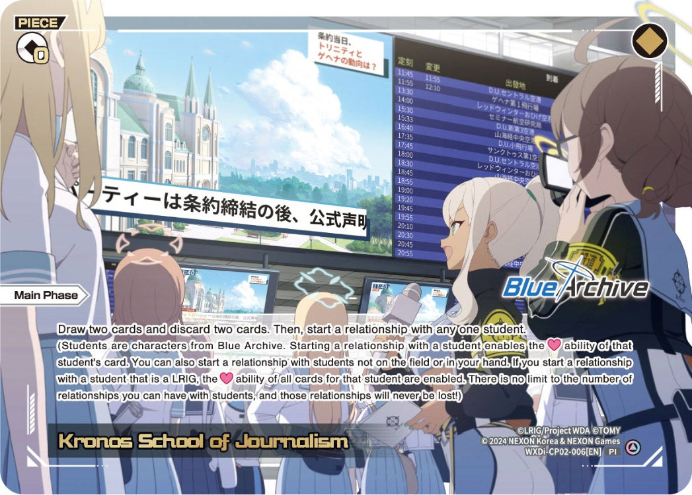

# Kronos School of Journalism

## Thông tin lá

| Trường | Giá trị |
| --- | --- |
| Mã in | WXDi-CP02-006[EN] |
| Set | WXDi-CP02[EN] |
| Số thứ tự | 006 |
| Loại thẻ | PIECE |
| Vị trí | LRIG Deck |
| Số bản | — (set booster, không áp dụng) |
| Màu | Không màu |
| Độ hiếm | PI,LRP |
| Minh họa | — |
| Level | — |
| Limit | — |
| Power | 0 |
| LRIG type / Class | — |
| Team / Master | — |
| Cost | 《C》×０ |
| Grow cost | — |
| Use timing | Main Phase |
| Life Burst | Không |

## Card text chính thức

Draw two cards and discard two cards. Then, start a relationship with any one student.
(Students are characters from Blue Archive. Starting a relationship with a student enables the [Relationship] ability of that student's card. You can also start a relationship with students not on the field or in your hand. If you start a relationship with a student that is a LRIG, the [Relationship] ability of all cards for that student are enabled. There is no limit to the number of relationships you can have with students, and those relationships will never be lost!)

## Power text / Life Burst

—

## Ghi chú minh họa
Artist: —. Ảnh PI được tải từ Card List tiếng Anh.

## FAQ chính thức

**Q. What does it mean to “start a relationship with any one student”?**
A. Declare the name of a student from Blue Archive DIVA and start a relationship with that student. Cards of students who have start a relationship will enable the [Relationship] ability. Please note that you are declaring the student's name, not the card name. If you have more than one ability to start a relationship, you will start a relationship with another student for that amount of time, and it will not be lost.
For example, if you declare “Ajitani Hifumi,” you will get 《Ajitani Hifumi [Help Me, Peroro!]》 and 《Ajitani Hifumi (Swimsuit)》 will both be enabled.
Please use the tokens include in the packs or the [Relationship] chips distributed at official events as a marker of who you started a relationship. You can also prepare your own markers as long as they are not mixed with other cards and are not designed in a way that is inconvenient for the game.

## Ảnh biến thể

- [LRP](../images/WXDi-CP02-006P-EN.jpg)

## Nguồn
[Card List/FAQ chính thức](https://www.takaratomy.co.jp/products/en.wixoss/card/card.html?card_no=WXDi-CP02-006%5BEN%5D ) · [Ảnh thẻ](https://www.takaratomy.co.jp/products/en.wixoss/card/thumb/WXDi-CP02-006%5BEN%5D.jpg)
