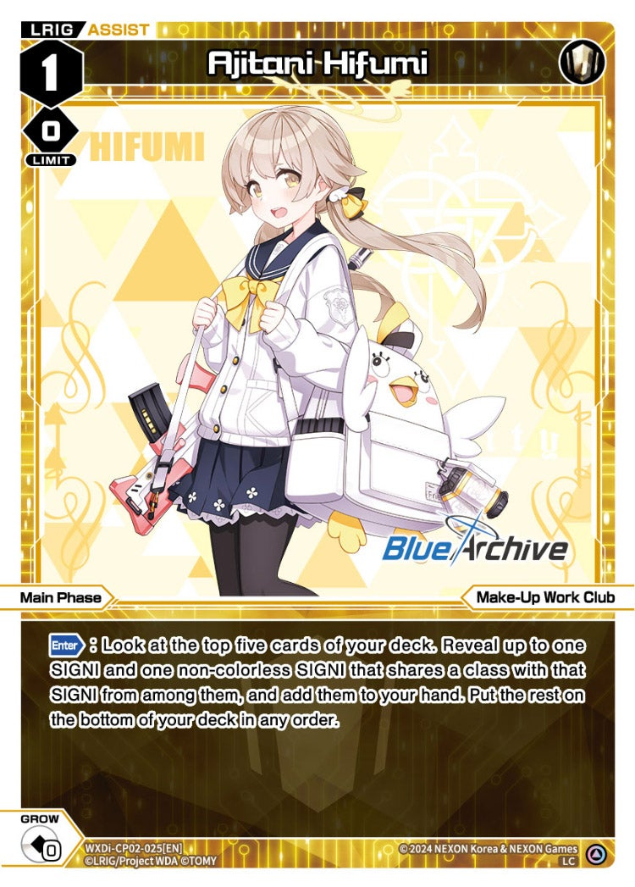

# Ajitani Hifumi

## Thông tin lá

| Trường | Giá trị |
| --- | --- |
| Mã in | WXDi-CP02-025[EN] |
| Set | WXDi-CP02[EN] |
| Số thứ tự | 025 |
| Loại thẻ | ASSIST LRIG |
| Vị trí | LRIG Deck |
| Số bản | — (set booster, không áp dụng) |
| Màu | Trắng |
| Độ hiếm | LC,LC(P) |
| Minh họa | — |
| Level | 1 |
| Limit | 0 |
| Power | 0 |
| LRIG type / Class | Make-Up Work Club |
| Team / Master | — |
| Cost | — |
| Grow cost | 《C》×０ |
| Use timing | Main Phase |
| Life Burst | Không |

## Card text chính thức

[Enter]: Look at the top five cards of your deck. Reveal up to one SIGNI and one non-colorless SIGNI that shares a class with that SIGNI from among them, and add them to your hand. Put the rest on the bottom of your deck in any order.

## Power text / Life Burst

—

## Ghi chú minh họa
Artist: —. Ảnh LC được tải từ Card List tiếng Anh.

## FAQ chính thức

**Q. What happens if I trigger this [Enter] ability when my deck has five or less cards?**
A. In that case, the effect is processed by looking at your whole deck of five or less cards. After this effect, if your deck is reduced to zero cards, refresh is performed, and if there is more than one card left in your deck, the game proceeds as is.

## Ảnh biến thể

- [LC(P)](../images/WXDi-CP02-025P-EN.jpg)

## Nguồn
[Card List/FAQ chính thức](https://www.takaratomy.co.jp/products/en.wixoss/card/card.html?card_no=WXDi-CP02-025%5BEN%5D ) · [Ảnh thẻ](https://www.takaratomy.co.jp/products/en.wixoss/card/thumb/WXDi-CP02-025%5BEN%5D.jpg)
