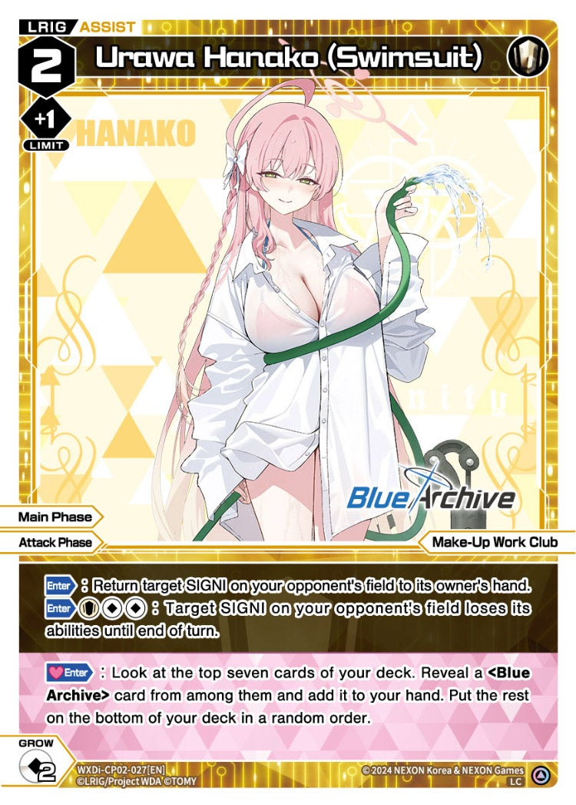

# Urawa Hanako (Swimsuit)

## Thông tin lá

| Trường | Giá trị |
| --- | --- |
| Mã in | WXDi-CP02-027[EN] |
| Set | WXDi-CP02[EN] |
| Số thứ tự | 027 |
| Loại thẻ | ASSIST LRIG |
| Vị trí | LRIG Deck |
| Số bản | — (set booster, không áp dụng) |
| Màu | Trắng |
| Độ hiếm | LC,LC(P) |
| Minh họa | — |
| Level | 2 |
| Limit | ＋１ |
| Power | 0 |
| LRIG type / Class | Make-Up Work Club |
| Team / Master | — |
| Cost | — |
| Grow cost | 《C》×２ |
| Use timing | Main Phase / Attack Phase |
| Life Burst | Không |

## Card text chính thức

[Enter]: Return target SIGNI on your opponent's field to its owner's hand.
[Enter] {White} {Colorless} {Colorless}: Target SIGNI on your opponent's field loses its abilities until end of turn.

[Relationship Enter]: Look at the top seven cards of your deck. Reveal a <Blue Archive> card from among them and add it to your hand. Put the rest on the bottom of your deck in a random order.

## Power text / Life Burst

—

## Ghi chú minh họa
Artist: —. Ảnh LC được tải từ Card List tiếng Anh.

## FAQ chính thức

**Q. May multiple [Enter] abilities be used in any order?**
A. Yes, multiple [Enter] abilities can be triggered in any order, including the [Relationship Enter] ability.

## Ảnh biến thể

- [LC(P)](../images/WXDi-CP02-027P-EN.jpg)

## Nguồn
[Card List/FAQ chính thức](https://www.takaratomy.co.jp/products/en.wixoss/card/card.html?card_no=WXDi-CP02-027%5BEN%5D ) · [Ảnh thẻ](https://www.takaratomy.co.jp/products/en.wixoss/card/thumb/WXDi-CP02-027%5BEN%5D.jpg)
