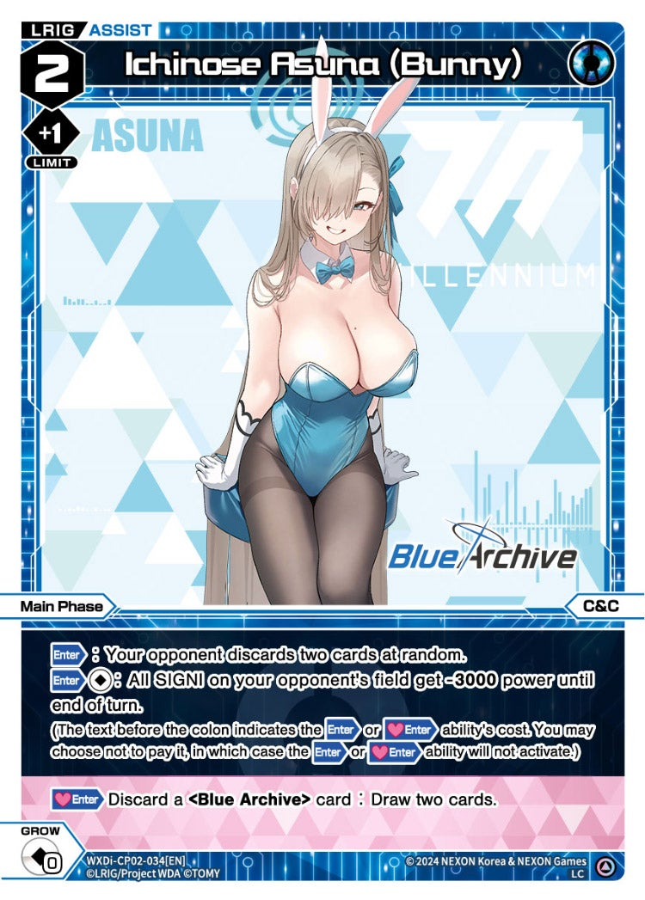

# Ichinose Asuna (Bunny)

## Thông tin lá

| Trường | Giá trị |
| --- | --- |
| Mã in | WXDi-CP02-034[EN] |
| Set | WXDi-CP02[EN] |
| Số thứ tự | 034 |
| Loại thẻ | ASSIST LRIG |
| Vị trí | LRIG Deck |
| Số bản | — (set booster, không áp dụng) |
| Màu | Xanh dương |
| Độ hiếm | LC,LC(P) |
| Minh họa | — |
| Level | 2 |
| Limit | ＋１ |
| Power | 0 |
| LRIG type / Class | C＆C |
| Team / Master | — |
| Cost | — |
| Grow cost | 《C》×０ |
| Use timing | Main Phase |
| Life Burst | Không |

## Card text chính thức

[Enter]: Your opponent discards two cards at random.
[Enter] {Colorless}: All SIGNI on your opponent's field get -3000 power until end of turn.
(The text before the colon indicates the [Enter] or [Relationship Enter] ability's cost. You may choose not to pay it, in which case the [Enter] or [Relationship Enter] ability will not activate.)

[Relationship Enter] Discard a <Blue Archive> card: Draw two cards.

## Power text / Life Burst

—

## Ghi chú minh họa
Artist: —. Ảnh LC được tải từ Card List tiếng Anh.

## FAQ chính thức

**Q. Does the second [Enter] ability also give -3000 power to the SIGNI that enters the my opponent's field later?**
A. No, only the SIGNI on your opponent's field when this effect trigger get -3000 power until end of turn.

**Q. How can I use the [Relationship Enter] ability?**
A. The effect of cards are to “Start a relationship with the student” and if you declare student's name from Blue Archive at that time, the [Releationship Enter] abilitiy will be enabled. [Relationship Enter] ability is be trigger when enter the field after started a relationship student.

## Ảnh biến thể

- [LC(P)](../images/WXDi-CP02-034P-EN.jpg)

## Nguồn
[Card List/FAQ chính thức](https://www.takaratomy.co.jp/products/en.wixoss/card/card.html?card_no=WXDi-CP02-034%5BEN%5D ) · [Ảnh thẻ](https://www.takaratomy.co.jp/products/en.wixoss/card/thumb/WXDi-CP02-034%5BEN%5D.jpg)
