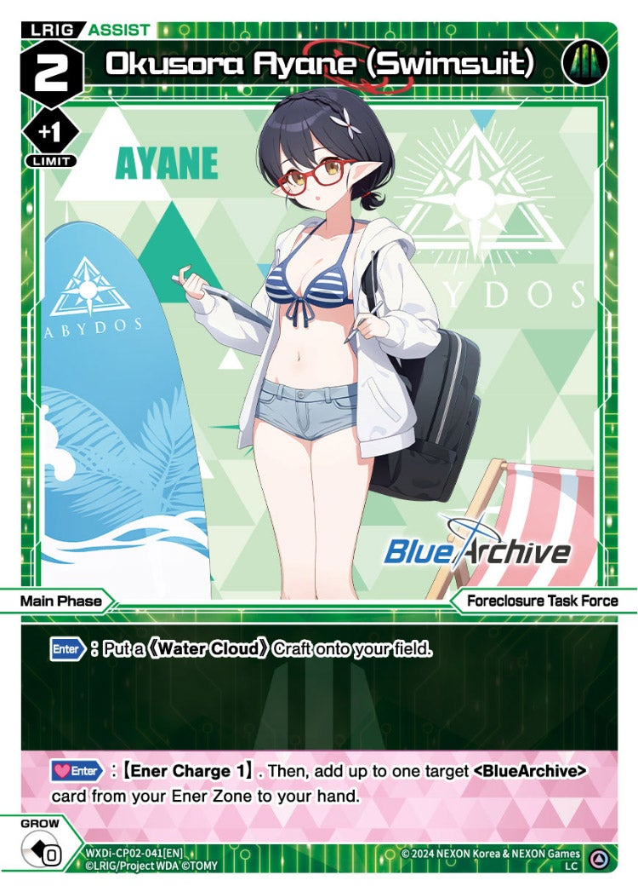

# Okusora Ayane (Swimsuit)

## Thông tin lá

| Trường | Giá trị |
| --- | --- |
| Mã in | WXDi-CP02-041[EN] |
| Set | WXDi-CP02[EN] |
| Số thứ tự | 041 |
| Loại thẻ | ASSIST LRIG |
| Vị trí | LRIG Deck |
| Số bản | — (set booster, không áp dụng) |
| Màu | Xanh lá |
| Độ hiếm | LC,LC(P) |
| Minh họa | — |
| Level | 2 |
| Limit | ＋１ |
| Power | 0 |
| LRIG type / Class | Foreclosure Task Force |
| Team / Master | — |
| Cost | — |
| Grow cost | 《C》×０ |
| Use timing | Main Phase |
| Life Burst | Không |

## Card text chính thức

[Enter]: Put a 《Water Cloud》 Craft onto your field.

[Relationship Enter]: 【Ener Charge 1】. Then, add up to one target <Blue Archive> card from your Ener Zone to your hand.

## Power text / Life Burst

—

## Ghi chú minh họa
Artist: —. Ảnh LC được tải từ Card List tiếng Anh.

## FAQ chính thức

**Q. What is Craft?**
A. Craft is a substitute card that is created during the game by the effect of a card. Please refer to the glossary “Craft” for detailed rules of Craft. Please use the tokens include in the pack when you play. You can also prepare your own markers as long as they are not mixed with other cards and are not designed in a way that is inconvenient for the game.

**Q. How can I use the [Relationship Enter] ability?**
A. The effect of cards are to “Start a relationship with the student” and if you declare student's name from Blue Archive at that time, the [Releationship Enter] abilitiy will be enabled. [Relationship Enter] ability is be trigger when enter the field after started a relationship student.

## Ảnh biến thể

- [LC(P)](../images/WXDi-CP02-041P-EN.jpg)

## Nguồn
[Card List/FAQ chính thức](https://www.takaratomy.co.jp/products/en.wixoss/card/card.html?card_no=WXDi-CP02-041%5BEN%5D ) · [Ảnh thẻ](https://www.takaratomy.co.jp/products/en.wixoss/card/thumb/WXDi-CP02-041%5BEN%5D.jpg)
