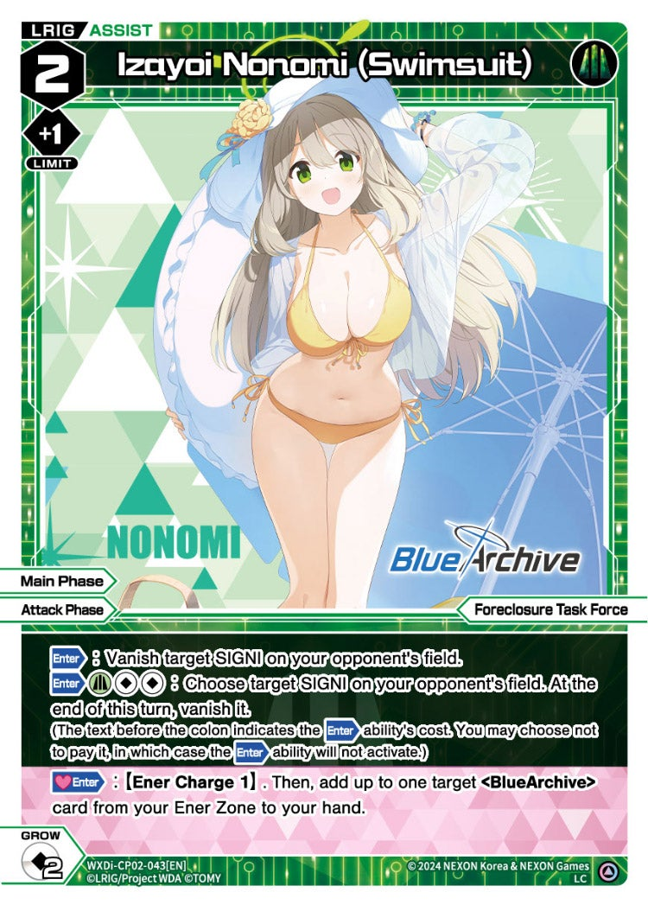

# Izayoi Nonomi (Swimsuit)

## Thông tin lá

| Trường | Giá trị |
| --- | --- |
| Mã in | WXDi-CP02-043[EN] |
| Set | WXDi-CP02[EN] |
| Số thứ tự | 043 |
| Loại thẻ | ASSIST LRIG |
| Vị trí | LRIG Deck |
| Số bản | — (set booster, không áp dụng) |
| Màu | Xanh lá |
| Độ hiếm | LC,LC(P) |
| Minh họa | — |
| Level | 2 |
| Limit | ＋１ |
| Power | 0 |
| LRIG type / Class | Foreclosure Task Force |
| Team / Master | — |
| Cost | — |
| Grow cost | 《C》×２ |
| Use timing | Main Phase
Attack Phase |
| Life Burst | Không |

## Card text chính thức

[Enter]: Vanish target SIGNI on your opponent's field.
[Enter] {Green} {Colorless} {Colorless}: Choose target SIGNI on your opponent's field. At the end of this turn, vanish it.
(The text before the colon indicates the [Enter] ability's cost. You may choose not to pay it, in which case the [Enter] ability will not activate.)

[Relationship Enter]: 【Ener Charge 1】. Then, add up to one target <Blue Archive> card from your Ener Zone to your hand.

## Power text / Life Burst

—

## Ghi chú minh họa
Artist: —. Ảnh LC được tải từ Card List tiếng Anh.

## FAQ chính thức

**Q. My opponent's SIGNI targeted by the second [Enter] ability was returned to their hand during that turn. What happens to the SIGNI with "at the end of this turn" ability?**
A. If the opponent's targeted SIGNI is moved from the field, the "at the end of this turn" effect does nothing.

**Q. How can I use the [Relationship Enter] ability?**
A. The effect of cards are to “Start a relationship with the student” and if you declare student's name from Blue Archive at that time, the [Releationship Enter] abilitiy will be enabled. [Relationship Enter] ability is be trigger when enter the field after started a relationship student.

## Ảnh biến thể

- [LC(P)](../images/WXDi-CP02-043P-EN.jpg)

## Nguồn
[Card List/FAQ chính thức](https://www.takaratomy.co.jp/products/en.wixoss/card/card.html?card_no=WXDi-CP02-043%5BEN%5D ) · [Ảnh thẻ](https://www.takaratomy.co.jp/products/en.wixoss/card/thumb/WXDi-CP02-043%5BEN%5D.jpg)
