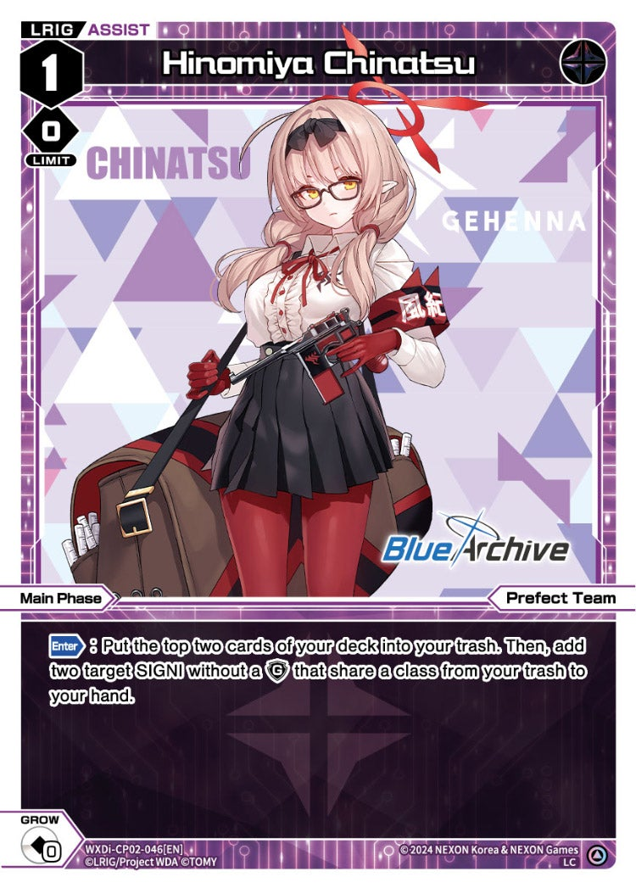

# Hinomiya Chinatsu

## Thông tin lá

| Trường | Giá trị |
| --- | --- |
| Mã in | WXDi-CP02-046[EN] |
| Set | WXDi-CP02[EN] |
| Số thứ tự | 046 |
| Loại thẻ | ASSIST LRIG |
| Vị trí | LRIG Deck |
| Số bản | — (set booster, không áp dụng) |
| Màu | Đen |
| Độ hiếm | LC,LC(P) |
| Minh họa | — |
| Level | 1 |
| Limit | 0 |
| Power | 0 |
| LRIG type / Class | Prefect Team |
| Team / Master | — |
| Cost | — |
| Grow cost | 《C》×０ |
| Use timing | Main Phase |
| Life Burst | Không |

## Card text chính thức

[Enter]: Put the top two cards of your deck into your trash. Then, add two target SIGNI without a {Guard Icon} that share a class from your trash to your hand.

## Power text / Life Burst

—

## Ghi chú minh họa
Artist: —. Ảnh LC được tải từ Card List tiếng Anh.

## FAQ chính thức

**Q. May I add only target one card in my trash to my hand by the [Enter] ability?**
A. No, this ability must target two cards, so only one cannot be targeted and cannot be added to your hand.

## Ảnh biến thể

- [LC(P)](../images/WXDi-CP02-046P-EN.jpg)

## Nguồn
[Card List/FAQ chính thức](https://www.takaratomy.co.jp/products/en.wixoss/card/card.html?card_no=WXDi-CP02-046%5BEN%5D ) · [Ảnh thẻ](https://www.takaratomy.co.jp/products/en.wixoss/card/thumb/WXDi-CP02-046%5BEN%5D.jpg)
