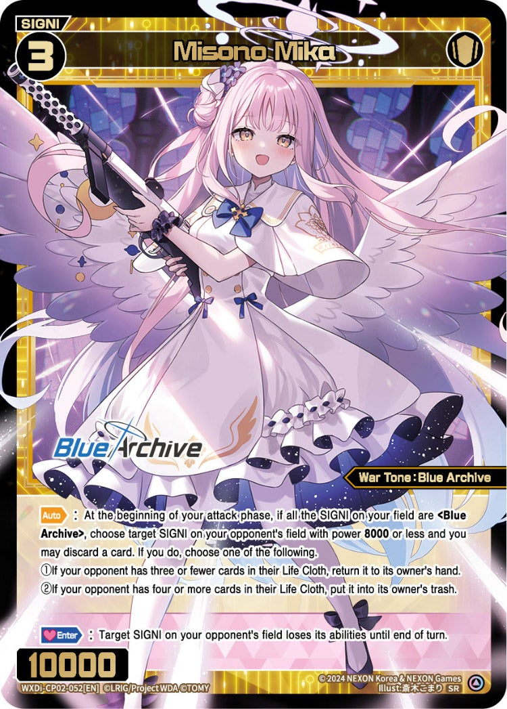

# Misono Mika

## Thông tin lá

| Trường | Giá trị |
| --- | --- |
| Mã in | WXDi-CP02-052[EN] |
| Set | WXDi-CP02[EN] |
| Số thứ tự | 052 |
| Loại thẻ | SIGNI |
| Vị trí | Main Deck |
| Số bản | — (set booster, không áp dụng) |
| Màu | Trắng |
| Độ hiếm | SR,SRP |
| Minh họa | 斉木こまり |
| Level | 3 |
| Limit | — |
| Power | 10000 |
| LRIG type / Class | War Tone：Blue Archive |
| Team / Master | — |
| Cost | — |
| Grow cost | — |
| Use timing | — |
| Life Burst | Không |

## Card text chính thức

[Auto]: At the beginning of your attack phase, if all the SIGNI on your field are <Blue Archive>, choose target SIGNI on your opponent's field with power 8000 or less and you may discard a card. If you do, choose one of the following.
①If your opponent has three or fewer cards in their Life Cloth, return it to its owner's hand.
②If your opponent has four or more cards in their Life Cloth, put it into its owner's trash.

[Relationship Enter]: Target SIGNI on your opponent's field loses its abilities until end of turn.

## Power text / Life Burst

—

## Ghi chú minh họa
Artist: 斉木こまり. Ảnh SR được tải từ Card List tiếng Anh.

## FAQ chính thức

**Q. Does the [Auto] ability trigger even if only this SIGNI is on my field?**
A. Yes, it will trigger. If there is no other SIGNI than <Blue Archive>, you can trigger it even if you have one or two SIGNI in your field.

**Q. What is the state of “loses its abilities”?**
A. The information in the text field will be treated as gone. Other information such as power, level, class, name, etc., will remain unchanged. Any effects that were gained later, such as “gains ~,” will also be lost.

**Q. How can I use the [Relationship Enter] ability?**
A. The effect of cards are to “Start a relationship with the student” and if you declare student's name from Blue Archive at that time, the [Releationship Enter] abilitiy will be enabled. [Relationship Enter] ability is be trigger when enter the field after started a relationship student.

## Ảnh biến thể

- [SRP](../images/WXDi-CP02-052P-EN.jpg)

## Nguồn
[Card List/FAQ chính thức](https://www.takaratomy.co.jp/products/en.wixoss/card/card.html?card_no=WXDi-CP02-052%5BEN%5D ) · [Ảnh thẻ](https://www.takaratomy.co.jp/products/en.wixoss/card/thumb/WXDi-CP02-052%5BEN%5D.jpg)
