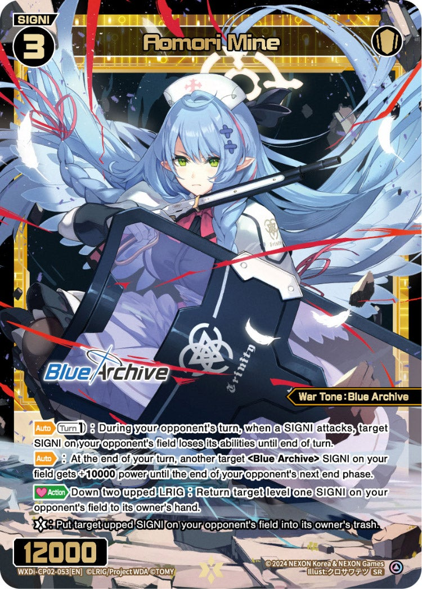

# Aomori Mine

## Thông tin lá

| Trường | Giá trị |
| --- | --- |
| Mã in | WXDi-CP02-053[EN] |
| Set | WXDi-CP02[EN] |
| Số thứ tự | 053 |
| Loại thẻ | SIGNI |
| Vị trí | Main Deck |
| Số bản | — (set booster, không áp dụng) |
| Màu | Trắng |
| Độ hiếm | SR,SRP |
| Minh họa | クロサワテツ |
| Level | 3 |
| Limit | — |
| Power | 12000 |
| LRIG type / Class | War Tone：Blue Archive |
| Team / Master | — |
| Cost | — |
| Grow cost | — |
| Use timing | — |
| Life Burst | Có |

## Card text chính thức

[Auto] {1/Turn}: During your opponent's turn, when a SIGNI attacks, target SIGNI on your opponent's field loses its abilities until end of turn.
[Auto]: At the end of your turn, another target <Blue Archive> SIGNI on your field gets +10000 power until the end of your opponent's next end phase.

[Relationship Action] Down two upped LRIG: Return target level one SIGNI on your opponent's field to its owner's hand.

## Power text / Life Burst

Put target upped SIGNI on your opponent's field into its owner's trash.

## Ghi chú minh họa
Artist: クロサワテツ. Ảnh SR được tải từ Card List tiếng Anh.

## FAQ chính thức

**Q. What is the state of “loses its abilities”?**
A. The information in the text field will be treated as gone. Other information such as power, level, class, name, etc., will remain unchanged. Any effects that were gained later, such as “gains ~,” will also be lost.

**Q. May the first [Auto] ability target other than the attacking SIGNI?**
A. Yes, you can target any of your opponent's SIGNI.

**Q. My opponent's attacked SIGNI with the “When this SIGNI attacks” ability. If it lose its abilities by this SIGNI's [Auto] ability, does it trigger?**
A. Both abilities trigger “When a SIGNI attacks”, but if there is more than one triggering ability, the turn player side will trigger first, so your opponent's SIGNI with “When this SIGNI attacks” will trigger first. After that is finished triggering, this SIGNI's [Auto] ability is triggered, targeting a SIGNI and lose its abilities.

**Q. How can I use the [Relationship Auto] ability?**
A. The effect of cards are to “Start a relationship with the student” and if you declare student's name from Blue Archive at that time, the [Releationship Auto] abilitiy will be enabled. The relationship will never be lost.

## Ảnh biến thể

- [SRP](../images/WXDi-CP02-053P-EN.jpg)

## Nguồn
[Card List/FAQ chính thức](https://www.takaratomy.co.jp/products/en.wixoss/card/card.html?card_no=WXDi-CP02-053%5BEN%5D ) · [Ảnh thẻ](https://www.takaratomy.co.jp/products/en.wixoss/card/thumb/WXDi-CP02-053%5BEN%5D.jpg)
