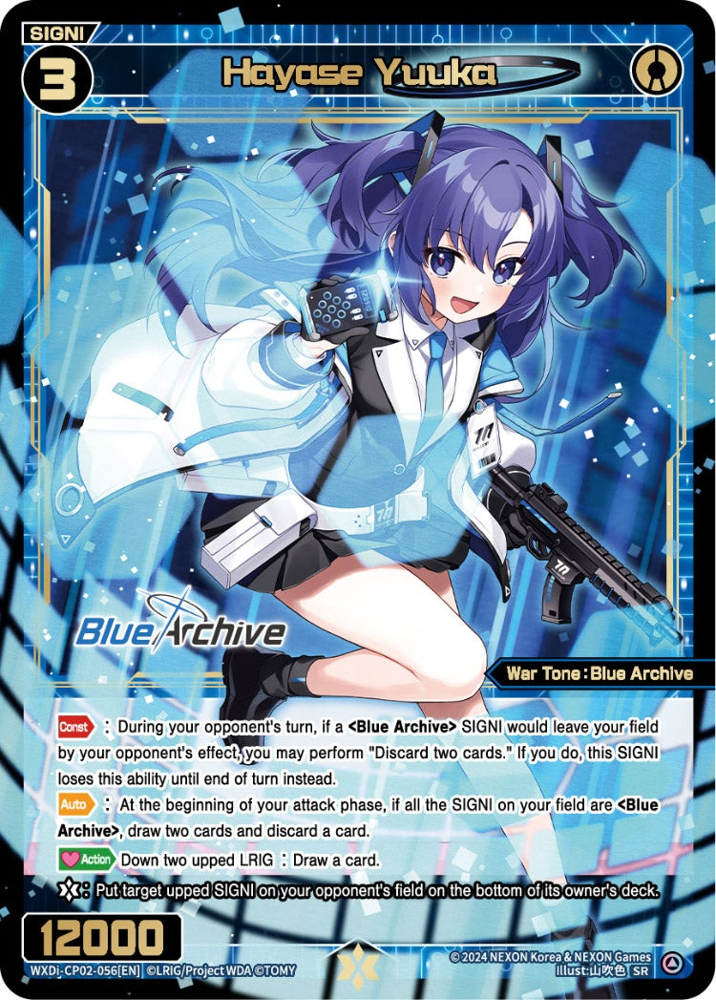

# Hayase Yuuka

## Thông tin lá

| Trường | Giá trị |
| --- | --- |
| Mã in | WXDi-CP02-056[EN] |
| Set | WXDi-CP02[EN] |
| Số thứ tự | 056 |
| Loại thẻ | SIGNI |
| Vị trí | Main Deck |
| Số bản | — (set booster, không áp dụng) |
| Màu | Xanh dương |
| Độ hiếm | SR,SRP |
| Minh họa | 山吹色 |
| Level | 3 |
| Limit | — |
| Power | 12000 |
| LRIG type / Class | War Tone：Blue Archive |
| Team / Master | — |
| Cost | — |
| Grow cost | — |
| Use timing | — |
| Life Burst | Có |

## Card text chính thức

[Constant]: During your opponent's turn, if a <Blue Archive> SIGNI would leave your field by your opponent's effect, you may perform "Discard two cards." If you do, this SIGNI loses this ability until end of turn instead.
[Auto]: At the beginning of your attack phase, if all the SIGNI on your field are <Blue Archive>, draw two cards and discard a card.

[Relationship Action] Down two upped LRIG: Draw a card.

## Power text / Life Burst

Put target upped SIGNI on your opponent's field on the bottom of its owner's deck.

## Ghi chú minh họa
Artist: 山吹色. Ảnh SR được tải từ Card List tiếng Anh.

## FAQ chính thức

**Q. If a <Blue Archive> SIGNI discards two cards in their hand instead of leaving the field, does the SIGNI stay on the field?**
A. Yes, the SIGNI stays on the field and 《Hayase Yuuka》 loses its abilities.

**Q. Does the [Auto] ability trigger even if only this SIGNI is on my field?**
A. Yes, it will trigger. If there is no other SIGNI than <Blue Archive>, you can trigger it even if you have one or two SIGNI in your field.

**Q. If my opponent's effect minus the power of my <Blue Archive> SIGNI, and its power becomes zero or less, can I use the [Const] ability to “Discard two cards”?**
A. No, it cannot. Even if the effect that minus power is your opponent's effect, “vanishing due to the power becoming zero or less” is a Rule-based Action process and does not leave by your opponent's effect.

**Q. How can I use the [Relationship Auto] ability?**
A. The effect of cards are to “Start a relationship with the student” and if you declare student's name from Blue Archive at that time, the [Releationship Auto] abilitiy will be enabled. The relationship will never be lost.

## Ảnh biến thể

- [SRP](../images/WXDi-CP02-056P-EN.jpg)

## Nguồn
[Card List/FAQ chính thức](https://www.takaratomy.co.jp/products/en.wixoss/card/card.html?card_no=WXDi-CP02-056%5BEN%5D ) · [Ảnh thẻ](https://www.takaratomy.co.jp/products/en.wixoss/card/thumb/WXDi-CP02-056%5BEN%5D.jpg)
