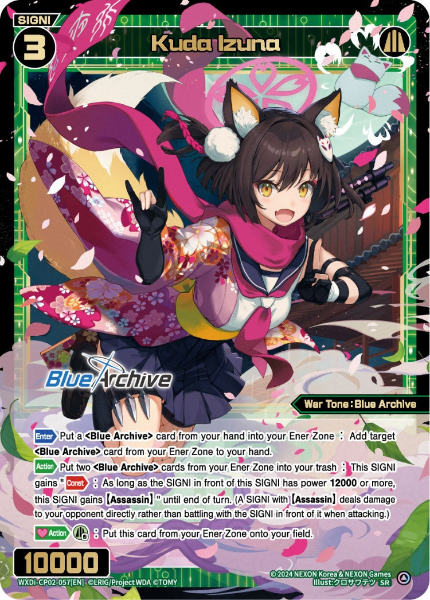

# Kuda Izuna

## Thông tin lá

| Trường | Giá trị |
| --- | --- |
| Mã in | WXDi-CP02-057[EN] |
| Set | WXDi-CP02[EN] |
| Số thứ tự | 057 |
| Loại thẻ | SIGNI |
| Vị trí | Main Deck |
| Số bản | — (set booster, không áp dụng) |
| Màu | Xanh lá |
| Độ hiếm | SR,SRP |
| Minh họa | クロサワテツ |
| Level | 3 |
| Limit | — |
| Power | 10000 |
| LRIG type / Class | War Tone：Blue Archive |
| Team / Master | — |
| Cost | — |
| Grow cost | — |
| Use timing | — |
| Life Burst | Không |

## Card text chính thức

[Enter] Put a <Blue Archive> card from your hand into your Ener Zone: Add target <Blue Archive> card from your Ener Zone to your hand.
[Action] Put two <Blue Archive> cards from your Ener Zone into your trash: This SIGNI gains "[Constant]: As long as the SIGNI in front of this SIGNI has power 12000 or more, this SIGNI gains 【Assassin】" until end of turn. (A SIGNI with 【Assassin】 deals damage to your opponent directly rather than battling with the SIGNI in front of it when attacking.)

[Relationship Action] {Greenx0}: Put this card from your Ener Zone onto your field.

## Power text / Life Burst

—

## Ghi chú minh họa
Artist: クロサワテツ. Ảnh SR được tải từ Card List tiếng Anh.

## FAQ chính thức

**Q. How can I use the [Relationship Auto] ability?**
A. The effect of cards are to “Start a relationship with the student” and if you declare student's name from Blue Archive at that time, the [Releationship Auto] abilitiy will be enabled. The relationship will never be lost.

## Ảnh biến thể

- [SRP](../images/WXDi-CP02-057P-EN.jpg)

## Nguồn
[Card List/FAQ chính thức](https://www.takaratomy.co.jp/products/en.wixoss/card/card.html?card_no=WXDi-CP02-057%5BEN%5D ) · [Ảnh thẻ](https://www.takaratomy.co.jp/products/en.wixoss/card/thumb/WXDi-CP02-057%5BEN%5D.jpg)
