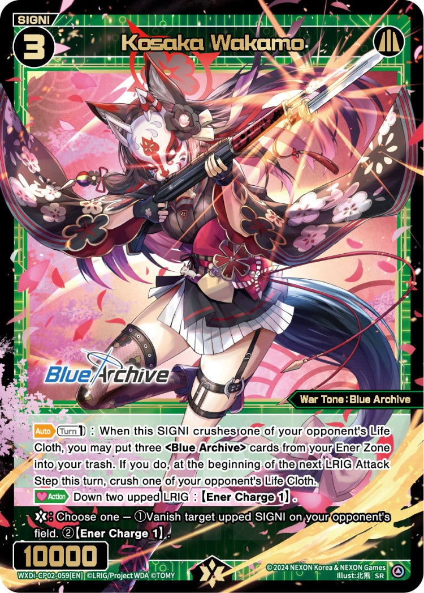

# Kosaka Wakamo

## Thông tin lá

| Trường | Giá trị |
| --- | --- |
| Mã in | WXDi-CP02-059[EN] |
| Set | WXDi-CP02[EN] |
| Số thứ tự | 059 |
| Loại thẻ | SIGNI |
| Vị trí | Main Deck |
| Số bản | — (set booster, không áp dụng) |
| Màu | Xanh lá |
| Độ hiếm | SR,SRP |
| Minh họa | 北熊 |
| Level | 3 |
| Limit | — |
| Power | 10000 |
| LRIG type / Class | War Tone：Blue Archive |
| Team / Master | — |
| Cost | — |
| Grow cost | — |
| Use timing | — |
| Life Burst | Có |

## Card text chính thức

[Auto] {1/Turn}: When this SIGNI crushes one of your opponent's Life Cloth, you may put three <Blue Archive> cards from your Ener Zone into your trash. If you do, at the beginning of the next LRIG Attack Step this turn, crush one of your opponent's Life Cloth.

[Relationship Action] Down two upped LRIG: 【Ener Charge 1】.

## Power text / Life Burst

Choose one — ①Vanish target upped SIGNI on your opponent's field. ②【Ener Charge 1】.

## Ghi chú minh họa
Artist: 北熊. Ảnh SR được tải từ Card List tiếng Anh.

## FAQ chính thức

**Q. How can I use the [Relationship Auto] ability?**
A. The effect of cards are to “Start a relationship with the student” and if you declare student's name from Blue Archive at that time, the [Releationship Auto] abilitiy will be enabled. The relationship will never be lost.

## Ảnh biến thể

- [SRP](../images/WXDi-CP02-059P-EN.jpg)

## Nguồn
[Card List/FAQ chính thức](https://www.takaratomy.co.jp/products/en.wixoss/card/card.html?card_no=WXDi-CP02-059%5BEN%5D ) · [Ảnh thẻ](https://www.takaratomy.co.jp/products/en.wixoss/card/thumb/WXDi-CP02-059%5BEN%5D.jpg)
