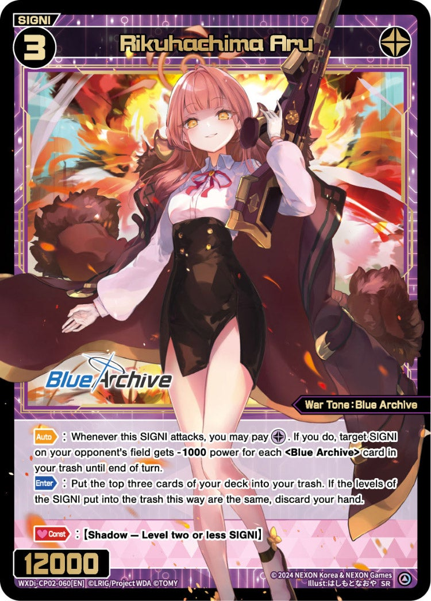

# Rikuhachima Aru

## Thông tin lá

| Trường | Giá trị |
| --- | --- |
| Mã in | WXDi-CP02-060[EN] |
| Set | WXDi-CP02[EN] |
| Số thứ tự | 060 |
| Loại thẻ | SIGNI |
| Vị trí | Main Deck |
| Số bản | — (set booster, không áp dụng) |
| Màu | Đen |
| Độ hiếm | SR,SRP |
| Minh họa | はしもとなおや |
| Level | 3 |
| Limit | — |
| Power | 12000 |
| LRIG type / Class | War Tone：Blue Archive |
| Team / Master | — |
| Cost | — |
| Grow cost | — |
| Use timing | — |
| Life Burst | Không |

## Card text chính thức

[Auto]: Whenever this SIGNI attacks, you may pay {Black}. If you do, target SIGNI on your opponent's field gets -1000 power for each <Blue Archive> card in your trash until end of turn.
[Enter]: Put the top three cards of your deck into your trash. If the levels of the SIGNI put into the trash this way are the same, discard your hand.

[Relationship Constant]: 【Shadow — Level two or less SIGNI】

## Power text / Life Burst

—

## Ghi chú minh họa
Artist: はしもとなおや. Ảnh SR được tải từ Card List tiếng Anh.

## FAQ chính thức

**Q. This SIGNI attacked and I used the [Auto] ability to vanish the SIGNI in front of it. Does this attack deal damage to my opponent?**
A. Yes, it does. As you attack, you must first resolve all the [Auto] abilities when you attack, etc. before the attack itself is processed, so if there are no more SIGNI in front of your SIGNI at that time, you will deal damage to your opponent.

**Q. What the effect does [Shadow] have?**
A. Prevents SIGNI with [Shadow] from being chosen by your opponent's effects that target SIGNI, such as "Target SIGNI". Conversely, it does not prevent an effect such as "Vanish all SIGNI", as it does not choose target SIGNI (in which case it will be vanished). [Shadow - level two or less] is not targeted by effect of level two or less SIGNI or LRIG, and Life Burst from cards that are level two or less SIGNI.

**Q. Does the [Enter] ability have to be triggered?**
A. Yes, the [Enter] ability without cost must be triggered.

**Q. How can I use the [Relationship Auto] ability?**
A. The effect of cards are to “Start a relationship with the student” and if you declare student's name from Blue Archive at that time, the [Releationship Auto] abilitiy will be enabled. The relationship will never be lost.

## Ảnh biến thể

- [SRP](../images/WXDi-CP02-060P-EN.jpg)

## Nguồn
[Card List/FAQ chính thức](https://www.takaratomy.co.jp/products/en.wixoss/card/card.html?card_no=WXDi-CP02-060%5BEN%5D ) · [Ảnh thẻ](https://www.takaratomy.co.jp/products/en.wixoss/card/thumb/WXDi-CP02-060%5BEN%5D.jpg)
